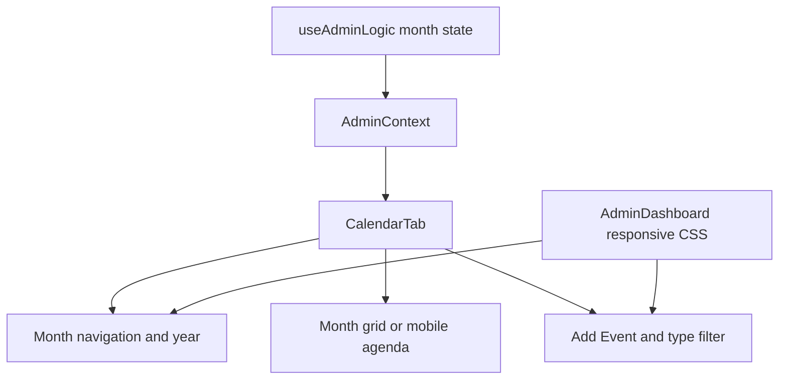

# RC1 engineering journal — defer Calendar Week View

Date: 8 October 2026
Scope: Admin Dashboard Calendar toolbar, RC1 only

> **Release continuity:** RC1 is complete. RC2 and RC3 followed; the final
> Admin release chronology is in
> [admin-dashboard-release-summary.md](admin-dashboard-release-summary.md).

## Problem

The Calendar toolbar offered Month and Week choices, but selecting Week changed
only the native select value. The Calendar continued to show the month grid on
larger screens and the month agenda on phones. This exposed an interaction the
application did not support.

## Root Cause

The Month/Week select was an uncontrolled placeholder. It had no value or
change handler, and the Calendar had no view state, week date calculations,
week navigation, week renderer, or week-specific responsive path. Calendar
state and navigation remained month-based regardless of the visible selection.

## Engineering Decision

Week View is deferred and removed from Release Candidate 1. The selector is
removed rather than disabled or replaced with placeholder messaging. Only the
implemented Month workflow remains visible.

## Why Removal Is Correct

A selectable option communicates that the product can perform an action.
Leaving Week selectable while rendering Month was misleading. A disabled
control would still occupy constrained toolbar space and advertise a feature
without approved requirements. Removing the unsupported selector makes the UI
truthful while preserving all implemented Calendar behavior.

## Why Week View Was Not Implemented

A complete Week View is a new feature, not a release correction. It requires
product decisions about week boundaries, cross-month navigation, event
placement, mobile presentation, accessibility, and whether existing time fields
should participate. Adding those decisions and their regression surface during
the Release Candidate would increase scope and risk.

Week View may return after it has approved product requirements, architecture,
responsive design, accessibility behavior, tests, and documentation. It is
deferred, not cancelled.

## Component Relationships



The removed selector had no connection to `useAdminLogic` or either rendering
path. The remaining controls retain their existing values, handlers, DOM order,
and keyboard order.

## Files Changed

- `frontend/src/pages/dashboards/admin/tabs/CalendarTab.jsx` — removes the
  unsupported Month/Week selector.
- `frontend/src/pages/dashboards/admin/AdminDashboard.jsx` — removes unused
  selector styling and changes the narrow action group from three columns to
  two.
- `e2e/admin-polish.spec.js` — removes the obsolete selector expectation and
  asserts that neither the selector nor Week option is exposed.
- `docs/ux-l4-engineering-journal.md` — records that RC1 supersedes the
  historical selector references without rewriting the L4 history.
- `docs/rc1-week-view-engineering-journal.md` — records this decision and its
  verification.

## Tests Updated

The focused L4 toolbar regression now expects the remaining controls in their
actual DOM order. It also checks that `.cal-view-select` and the Week option are
absent. Existing assertions continue to cover two deliberate rows, intact
groups, zero toolbar overflow, filtering, and control order.

## Documentation Updated

This journal records the RC1 decision and future-entry conditions. The L4
journal retains its historical account and links to this superseding release
decision.

## Engineering Impact Analysis

| Area | Affected | Explanation |
|---|---|---|
| Calendar Grid | NO | Month grid markup, calculation, and events are unchanged. |
| Agenda | NO | The mobile month agenda is unchanged. |
| Toolbar | YES | The unsupported selector is removed; the narrow action row now has two columns. |
| Filtering | NO | The same select value, options, and callback remain. |
| Dialogs | NO | Add, edit, and delete behavior are unchanged. |
| Theme | NO | No color, surface, or theme token changes. |
| Accessibility | YES | A misleading unnamed control is removed; remaining keyboard order is preserved. |
| Tests | YES | The focused toolbar expectation follows the supported controls. |
| Documentation | YES | Week View is recorded as deferred from RC1. |
| Performance | NO | Removing one static control has no meaningful runtime effect. |

## Complexity Analysis

Before: **O(1)** toolbar rendering and event handling.

After: **O(1)** toolbar rendering and event handling.

The number of controls remains fixed. No state, loop, request, or behavioral
complexity is added.

## Before vs After

### Before

- Week selector visible.
- Selecting Week did not change Calendar rendering or navigation.
- The toolbar exposed a misleading interaction.

### After

- Only the supported Month workflow remains.
- Month navigation, Add Event, filtering, grid, and agenda behave as before.
- The toolbar exposes no unsupported view choice.

### Why better

Release UI should represent capabilities that exist. Removing the placeholder
keeps the Calendar understandable and maintainable without introducing an
incomplete feature or a promise the current release cannot fulfill.

## Verification

The focused Calendar toolbar regression and responsive browser matrix covered:

- 360, 390, 768, 1024, and 1440px;
- light and dark themes;
- two-row phone and single-row wider toolbar layout;
- toolbar and body overflow;
- Month navigation, Add Event, and event filtering;
- keyboard order and the absence of Week View;
- no application write requests during verification.

Focused committed regression:

```text
npx playwright test e2e/admin-polish.spec.js --grep "calendar controls"
```

Result: **4 passed, 0 failed, 0 skipped** in 22.8s. This includes the updated
L4 two-row regression and the existing 360/768/1440 target-size checks.

An ignored, temporary Playwright matrix exercised all ten combinations of
light/dark and 360/390/768/1024/1440px. Result: **10 passed, 0 failed, 0
skipped** in 43.9s. It measured two toolbar rows at 360/390 and one row at
768/1024/1440, with each group on one row and 0px toolbar/body overflow. Every
case changed the event filter, navigated forward and back one month, and opened
and cancelled Add Event. No `POST`, `PUT`, `PATCH`, or `DELETE` request reached
the Supabase REST API.

The first matrix attempt timed out before reaching Calendar because the
temporary harness looked for a Settings `Theme` select on the Overview page.
The harness was corrected to use the existing header theme button; this was a
verification-harness error, not an application failure.

All ten screenshots were visually inspected. The period controls and action
controls remain aligned, spacing is consistent, labels are unclipped, and the
light/dark surfaces match the existing dashboard at every required width.

Ignored local evidence:

- `screenshots/admin-recovery-2026-10-08/rc1-after/*.png`
- `screenshots/admin-recovery-2026-10-08/rc1-after/observations.json`

## Regression Risk

**LOW.** The change removes one disconnected control and adjusts only the
column count of its existing narrow layout group. Calendar state, rendering,
data access, dialogs, event mutations, filtering, and navigation are untouched.

## Future Considerations

Week View may be proposed for a future version only with:

- approved behavior and user need;
- a defined week boundary and navigation model;
- desktop and mobile designs;
- accessible names, state, and keyboard behavior;
- event-range and optional time-field decisions;
- focused automated and visual regression coverage;
- user-facing and engineering documentation.
