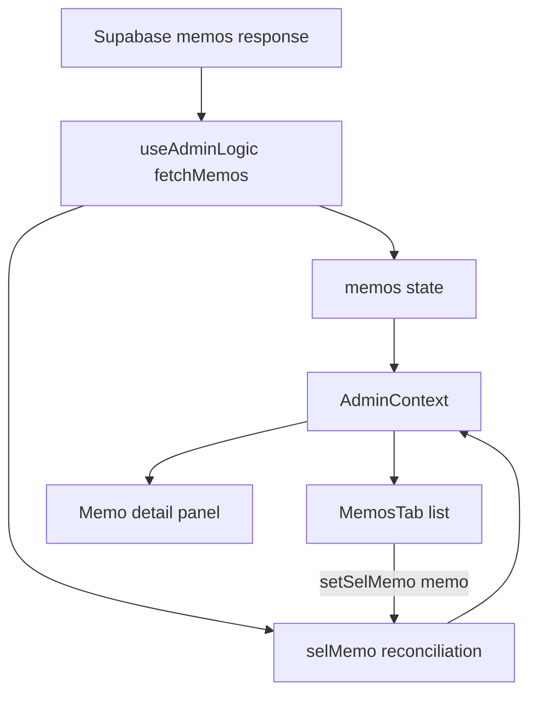

# RC2 engineering journal — Memo selection stability

Date: 8 October 2026
Scope: Admin Dashboard Memo selection, RC2 only

> **Release continuity:** RC2 is complete. RC3 followed; the final Admin
> release chronology is in
> [admin-dashboard-release-summary.md](admin-dashboard-release-summary.md).

## Problem

Selecting a memo other than the first row was not stable across a memo-list
refresh. The save path fetched the list again after an update; when that fetch
completed, the preview and active row jumped to the first memo instead of
remaining on the memo the administrator had selected.

The pre-fix browser regression reproduced the issue with live writes
intercepted: `Submission of Quarterly Reports` was selected, but the refresh
changed the active row to `Updated Faculty Meeting Schedule`.

## Root Cause

Memo selection lives in `useAdminLogic` as `selMemo`. `MemosTab` receives it
through `AdminContext`, marks the matching list button active, and renders that
object in the detail panel.

`fetchMemos` was wrapped in `useCallback(..., [])`, but its success path read
`selMemo` directly:

```js
if (data?.length && !selMemo) setSelMemo(data[0]);
```

Because the callback was created on the initial render, it permanently
captured the initial `null`. Every later fetch therefore evaluated the
selection as empty and selected the first row. The stale closure was reached
after memo saves and any other caller that refreshed the memo list.

## Architecture

`useAdminLogic` owns memo records, selection, form state, fetches, and
mutations. `AdminProvider` exposes that state through `AdminContext`.
`MemosTab` remains a presentation and interaction consumer.

No selection state was moved and no second source of truth was introduced.

## Component Relationships



## Data Flow

1. `MemosTab` calls `setSelMemo(memo)` when a list row is activated.
2. The context rerenders the list and detail panel from that selected object.
3. Saving calls `fetchMemos` after the mutation completes.
4. `fetchMemos` stores the fresh memo array.
5. A functional `setSelMemo` reads the actual current selection at update time.
6. The matching fresh row is retained by ID. If it no longer exists, the first
   available memo is selected; an empty response clears the selection.

## Existing Pattern Reused

The Admin hook already uses React functional state setters when an asynchronous
callback must apply work to the latest state, including statistics and user
updates. RC2 uses that same pattern instead of adding a ref, effect, or parallel
selection ID.

## UX Decision

### Current behavior

A refresh silently moved the active row and preview to the first memo.

### Problem

The administrator lost context after editing a memo, even though the selected
record still existed.

### Alternatives considered

1. **Add `selMemo` to `fetchMemos` dependencies.**
   - Keeps the closure current.
   - Recreates `fetchMemos` whenever selection changes. Because the initial
     load effect depends on `fetchMemos`, selection would retrigger the broader
     dashboard load path.
   - Rejected because it expands requests and couples selection to fetching.
2. **Mirror selection in a ref.**
   - Gives a stable callback access to the latest value.
   - Adds duplicate state and a synchronization effect.
   - Rejected because React's functional setter already solves the problem.
3. **Use a functional setter and reconcile by ID.**
   - Reads current state without changing callback identity.
   - Refreshes the selected object from the new response.
   - Handles deleted and empty results coherently.
   - Chosen as the smallest complete fix.

## Engineering Decision

Keep `fetchMemos` stable and replace the stale closure read with:

```js
setSelMemo(current => (
  nextMemos.find(memo => memo.id === current?.id) || nextMemos[0] || null
));
```

This preserves component ownership, selection behavior, and the existing
request flow while ensuring the detail panel receives the fresh selected row.

## Files Changed

- `frontend/src/pages/dashboards/admin/useAdminLogic.jsx` — reconciles Memo
  selection inside a functional state update.
- `e2e/admin-memo-selection.spec.js` — reproduces and guards the save/refetch
  selection path with database writes intercepted.
- `docs/rc2-memo-selection-engineering-journal.md` — records the decision,
  verification, impact, and release note.

## Tests Updated

A new focused Playwright regression:

- selects the second memo;
- opens its existing Edit dialog;
- intercepts the memo PATCH and activity-log POST;
- allows the real read-only memo refetch;
- asserts that the same memo remains the single active row.

Before the fix it failed with the first memo active. After the fix it passes.

## Verification

Focused red/green regression:

```text
npx playwright test e2e/admin-memo-selection.spec.js
```

- Before fix: **1 failed** — expected `Submission of Quarterly Reports`,
  received `Updated Faculty Meeting Schedule`.
- After fix: **1 passed** in 6.8s.

Memo-only regression:

```text
npx playwright test e2e/admin-memo-selection.spec.js e2e/admin-memo-recipients.spec.js
```

Result: **4 passed, 0 failed, 0 skipped** in 16.4s.

An ignored temporary browser matrix exercised 390px mobile, 768px tablet, and
1440px desktop in light and dark themes. Result: **6 passed, 0 failed, 0
skipped** in 47.0s.

Every matrix case verified:

- the second memo remained selected after refresh;
- exactly one memo row was active;
- the list retained the same row count;
- focus returned to the existing Edit button after the dialog closed;
- body overflow was 0px;
- the save path's PATCH and audit POST were intercepted and did not reach the
  live database.

All six screenshots were inspected. List/detail alignment, active styling,
toolbar wrapping, text truncation, spacing, and light/dark surfaces remained
consistent with the existing Memo UI.

Ignored local evidence:

- `screenshots/admin-recovery-2026-10-08/rc2-after/*.png`
- `screenshots/admin-recovery-2026-10-08/rc2-after/observations.json`

## Engineering Impact

| Area | Affected | Explanation |
|---|---|---|
| Memo List | YES | Its active row now remains synchronized after refresh. |
| Memo Detail | YES | It receives the fresh object for the same selected ID. |
| Selection State | YES | The stale closure read is replaced by a functional update. |
| Filtering | NO | Filter state and calculation are unchanged. |
| Search | NO | Search state and calculation are unchanged. |
| Dialogs | NO | Modal structure, fields, focus contract, and handlers are unchanged. |
| Theme | NO | No styles or tokens changed. |
| Accessibility | NO regression | `aria-current`, buttons, and focus restoration remain intact. |
| Performance | YES, negligible | Reconciliation scans the fetched memo array once. No request or render path is added. |
| Shared Components | NO | Context and shared component APIs are unchanged. |

## Complexity

Before, the broken `!selMemo` check was **O(1)**.

After, selection reconciliation is **O(n)** in the number of fetched memos
because it locates the current ID in the fresh array. The surrounding list
fetch, storage, filtering, and rendering are already O(n), so end-to-end Memo
refresh complexity remains **O(n)**. This small scan avoids duplicate state and
ensures the selected detail uses current server data.

## Regression Risk

**LOW.** One state assignment changed inside the existing successful fetch
path. The callback remains stable, no dependency or effect changed, no request
was added, and no component API or markup changed. The direct regression and
six-case visual matrix cover the affected flow.

## Future Notes

- Keep selection reconciliation inside the state setter while `fetchMemos`
  remains a stable callback used by the dashboard load path.
- If memo pagination is introduced, define whether a selection outside the
  loaded page should remain visible before changing this fallback behavior.
- Do not add a selection ref unless a future non-state callback requires it;
  current React state already supplies the needed synchronization.

## Release Notes

### RC2

Resolved: ✓ Memo stale-selection issue.

Reason: Memo refresh now reconciles against the current selection rather than
an initial stale closure.

Impact: Correct selection and fresh detail data are restored after refresh.
No UX, backend, database, or API-contract changes.
