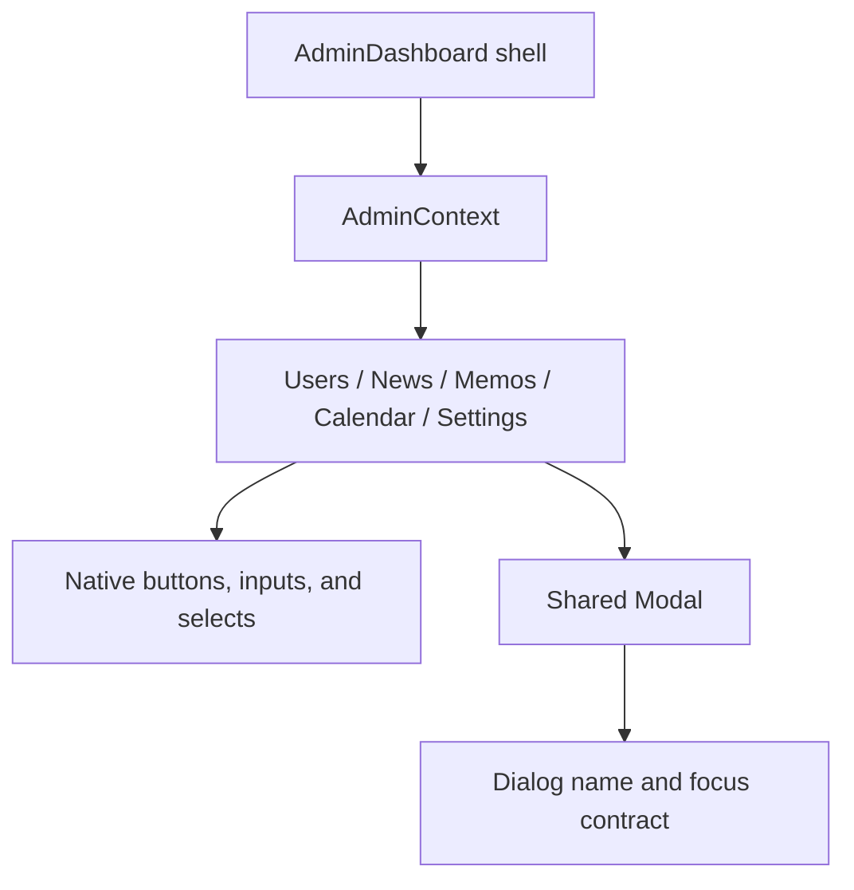

# RC3 engineering journal — Admin accessibility release pass

Date: 8 October 2026
Scope: Admin Dashboard, Users, News, Memos, Calendar, Settings, and shared Admin dialogs

## Problem

The release pass found three material accessibility defects:

1. The Users role filter, both News filters, and the Calendar event-type filter
   had no accessible names. Their current option text described a value, but
   did not identify the control's purpose consistently.
2. Calendar's previous/next controls were announced only as `‹` and `›`, and
   every Upcoming action was announced as the same bare `Edit` or `Remove`.
3. Required News, Calendar, and Memo fields were enforced by save handlers but
   did not expose their required state to assistive technology.

These are **MEDIUM** findings. They materially affect screen-reader users but
do not block pointer use, expose data, or corrupt state. No HIGH, LOW, or
COSMETIC release finding was confirmed.

## Root Cause

The affected toolbar controls relied on visible option text instead of an
explicit name. Calendar's compact buttons relied on visual position or nearby
card content. Form validation existed in `useAdminLogic`, while the matching
inputs did not carry `aria-required`, so the requirement became known only
after an attempted save.

The shared `Modal` was not a cause. It already supplies `role="dialog"`,
`aria-modal`, a title through `aria-labelledby`, initial focus, Tab and
Shift+Tab trapping, Escape handling, and focus restoration.

## Architecture

`AdminDashboard` owns the shell and active-page navigation. `AdminContext`
provides state and handlers from `useAdminLogic`. The scoped tab components
render native controls and shared `Modal` instances. RC3 leaves this ownership
unchanged and adds semantics at the elements that own each accessible name or
required state.



## Accessibility Decision Log

### Toolbar controls

Explicit `aria-label` values were added to the four unnamed filters. Visible
copy and layout stay unchanged. Adding separate visible labels was rejected
because it would redesign established compact toolbars.

### Calendar controls and row actions

The navigation glyphs now expose `Previous month` and `Next month`. Upcoming
actions include the event title, such as `Edit Midterm Examinations`. Replacing
the glyphs or expanding visible button text was rejected because the existing
responsive toolbar and card layout are otherwise valid.

### Required fields

`aria-required="true"` was added where the existing save logic requires a
value, including conditional custom-audience and custom-event-type inputs.
Native `required` was rejected because it would introduce browser validation
and alter the current save/toast behavior. Read-only published News fields do
not expose an actionable requirement.

### No-finding decisions

- **Dialogs — NO FINDING:** names, modal semantics, initial focus, trapping,
  Escape, and restoration passed browser tests. `aria-describedby` is optional
  here; the forms contain individually named controls rather than one concise
  dialog description.
- **Keyboard navigation — NO FINDING:** sidebar activation, Calendar keyboard
  navigation, Tab/Shift+Tab containment, and Escape behavior are operable.
- **Focus visibility — NO FINDING:** keyboard and programmatic focus regressions
  passed, and the focus outline remained visible in both themes at every
  required width.
- **Tables and lists — NO FINDING:** native headers remain associated with
  their tables; active navigation and Memo selection already expose current
  state.
- **Settings — NO FINDING:** visible controls retain programmatic labels and
  the disabled Portal Name explanation remains present.
- **Theme — NO FINDING:** no contrast regression was observed. The existing
  measured Logout test passed at 12.45:1 dark and 14.11:1 light.

## Implementation

- Added accessible names to Users, News, and Calendar filters.
- Added meaningful names and explicit button types to Calendar month controls.
- Added event-specific names to Calendar Upcoming Edit and Remove actions.
- Exposed required state on enforced News, Calendar, and Memo fields.
- Added focused Playwright regression coverage for all three finding groups,
  including keyboard-forward and mouse-backward Calendar navigation.

The change is semantic only. It does not change styling, layout, network
requests, state ownership, validation rules, or mutation behavior.

## Files Changed

- `frontend/src/pages/dashboards/admin/tabs/UsersTab.jsx`
- `frontend/src/pages/dashboards/admin/tabs/NewsTab.jsx`
- `frontend/src/pages/dashboards/admin/tabs/MemosTab.jsx`
- `frontend/src/pages/dashboards/admin/tabs/CalendarTab.jsx`
- `e2e/admin-a11y.spec.js`
- `docs/rc3-accessibility-engineering-journal.md`

## Engineering Impact

| Area | Affected | Explanation |
|---|---|---|
| Dashboard | NO | Shell rendering and navigation behavior are unchanged. |
| Users | YES | The role filter now has a programmatic name. |
| News | YES | Filters are named and required form fields expose their state. |
| Memos | YES | The required Subject field exposes its state. |
| Calendar | YES | Toolbar and Upcoming actions are named; required fields expose their state. |
| Settings | NO | Inspection and matrix verification found no release defect. |
| Dialogs | NO | Shared dialog code is unchanged; its existing focus contract passed. |
| Accessibility | YES | Names, contextual action identity, and required-state semantics improve. |
| Theme | NO | No CSS, colors, tokens, or theme behavior changed. |
| Performance | NO | Static attributes add no meaningful runtime work. |
| Shared Components | NO | `Modal`, `Button`, context APIs, and focus utilities are unchanged. |

## Complexity

Before: **O(1)** per affected control render and interaction.

After: **O(1)** per affected control render and interaction.

The dynamic action labels interpolate the event title already available in the
same render. No collection traversal, request, state, or effect was added.

## Risk

**LOW.** The production changes are limited to semantic attributes and explicit
button types. No CSS or event handler changed. Regression coverage exercises
the affected names, conditional required fields, keyboard and mouse
activation, shared dialog focus behavior, theme contrast, and the responsive
matrix.

## Verification

Pre-fix focused regression:

```text
npx playwright test e2e/admin-a11y.spec.js --grep "toolbar filters|Upcoming actions|required News"
```

Result: **3 failed**. The browser reported an empty Users role-filter name,
bare Calendar `Edit` actions, and no `aria-required` on the News title.

Post-fix focused regression: **3 passed** in 14.2s.

Final Admin accessibility regression:

```text
npx playwright test e2e/admin-a11y.spec.js
```

Result: **8 passed, 0 failed, 0 skipped** in 36.7s.

Focused shared-dialog regression:

```text
npx playwright test e2e/admin-modal.spec.js --grep "it is a dialog|focus moves|Tab cycles|dialog takes focus|delete confirmation opens"
```

Result: **9 passed, 0 failed, 0 skipped** in 37.6s.

Focused focus-visibility regression:

```text
npx playwright test e2e/admin-polish.spec.js --grep "wear a single ring|field in a modal rings|focusing a field does not reshape|reached by Tab|however focus arrived"
```

Result: **6 passed, 0 failed, 0 skipped** in 24.8s.

Existing light/dark contrast regression:

```text
npx playwright test e2e/admin-drawer.spec.js --grep "Logout label clears"
```

Result: **2 passed, 0 failed, 0 skipped** in 8.9s. Measured text contrast was
12.45:1 in dark mode and 14.11:1 in light mode.

An ignored temporary browser matrix covered 360, 390, 768, 1024, and 1440px
in light and dark themes. Result: **10 passed, 0 failed, 0 skipped** in 4.8m.
Each case visited Dashboard, Users, News, Memos, Calendar, and Settings; checked
every visible control for a non-empty accessible name; checked body overflow;
and measured a visible Calendar focus outline. The first combined matrix run
reached its 180s harness timeout without an assertion failure, so the same
coverage was split into ten bounded cases.

All ten Calendar screenshots were inspected. Toolbar grouping, focus outline,
agenda/grid switching, event text, Upcoming actions, spacing, and surfaces
remained intact in both themes. Evidence is stored as ignored local artifacts
under `screenshots/admin-recovery-2026-10-08/rc3-after/`.

Broader suites, lint, build, and non-Admin tests were skipped because RC3 calls
for accessibility-only regression and explicitly defers Lint Triage and Manual
QA. Playwright compiled and exercised every changed JSX module.

## Release Notes

### RC3

Resolved:

- Named the Users, News, and Calendar toolbar filters for assistive technology.
- Added meaningful names to Calendar month navigation and Upcoming actions.
- Exposed required state on enforced News, Calendar, and Memo form fields.

## Future Notes

- Preserve event-specific action names when Calendar cards change.
- Keep conditional required semantics synchronized with the existing save
  rules if News audiences or Calendar event types change.
- Documentation Reconciliation, Lint Triage, and Manual QA remain separate
  release tasks and were not started during RC3.
