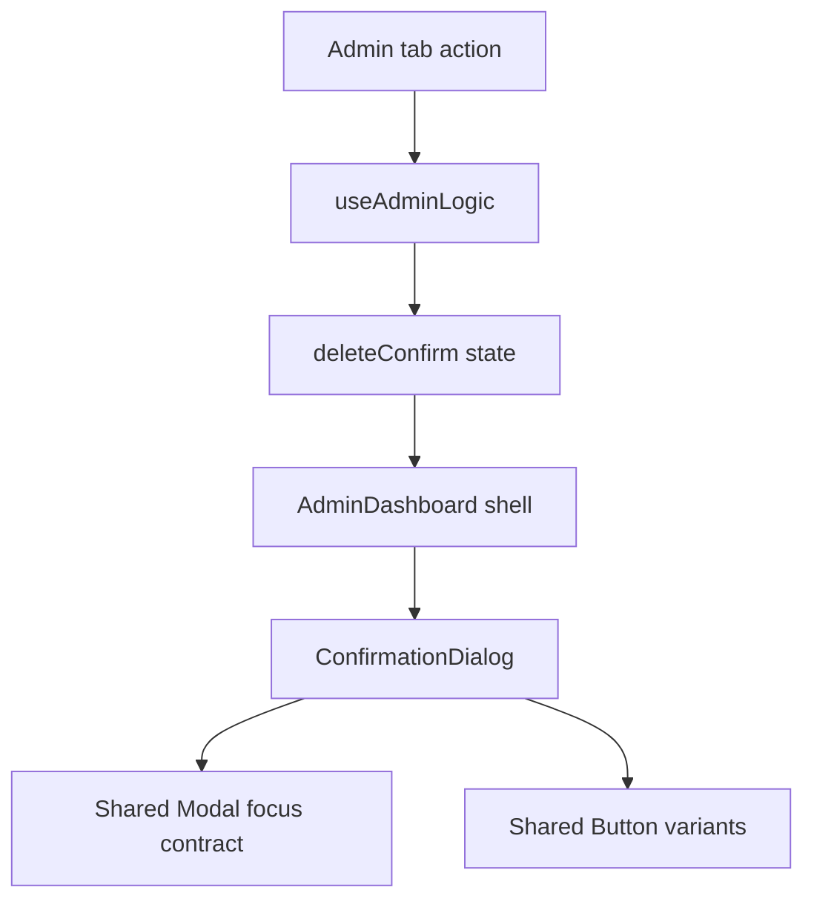

# Sprint A engineering journal — Password UX, confirmations, and logout

Date: 8 October 2026
Scope: Admin Dashboard only

## Problem

Sprint A addressed three bounded Admin interaction problems:

1. The Create User form exposed one text-based password reveal control that
   changed both Password and Confirm Password together. It gave no feedback
   about password composition while the administrator typed.
2. News, Calendar, and Memos called the browser's native `confirm()` for
   permanent deletion while Users and the academic Admin screens used the
   portal's accessible modal. The same class of action therefore had two
   keyboard, focus, theme, and wording behaviors.
3. Logout executed immediately. An accidental press ended the session without
   a chance to cancel.

## Root Cause

Password visibility was represented by one `revealPass` state shared by both
fields. The delete handlers for News, Calendar, and Memos predated the shared
Admin confirmation state and retained direct `confirm()` calls. Logout was an
inline handler that called `logout()` and then the existing `/login` navigation
without a confirmation state.

The Users archive control also started its post-removal focus timer before the
confirmation decision. If the dialog remained open for two seconds, that timer
could focus a control behind the modal. The timer now starts only after the
administrator confirms the archive action.

## Architecture

The implementation keeps existing ownership:



`useAdminLogic` still owns all Supabase mutations, activity logging, refreshes,
and toasts. `AdminDashboard` still owns logout and routing. `UsersTab` owns only
the presentation state for the two password fields and the informational meter.

## Engineering Decisions

### Password controls

Each password input now has its own masked/unmasked state and a 44px icon
button using the existing Lucide icon set. The controls expose `aria-label`,
`aria-controls`, and `aria-pressed`; their icons are hidden from the accessible
name.

The strength meter scores five deterministic signals already reflected in the
project's password guidance: at least 12 characters, lowercase, uppercase,
number, and special character. It reports Weak, Fair, Good, or Strong while
typing. It does not block submission, alter `validatePassword`, add a field, or
change account-creation data.

A new password policy or third-party estimator was rejected because Sprint A
requires guidance rather than stronger validation. A shared reveal state was
rejected because the two fields must be inspectable independently.

### Confirmation dialog

The existing delete-modal markup was extracted into one Admin
`ConfirmationDialog`, built on the existing `Modal` and `Button`. It preserves
the established appearance and supplies the current dialog name, initial focus
on Cancel, Tab and Shift+Tab containment, Escape handling, backdrop behavior,
and focus restoration.

News, Calendar, and Memos now populate the same `deleteConfirm` state already
used by Users and academic Admin actions. Their Supabase calls, activity logs,
toasts, selections, and refetches remain in their original handlers and run
only from `onConfirm`. The two remaining browser prompts protect unsaved form
and Settings changes; they are not delete actions and were intentionally left
outside Sprint A.

Creating separate dialogs in each tab was rejected because it would duplicate
the focus contract. Moving data mutations into the dialog was rejected because
it would break the current logic ownership.

### Logout

The Logout button now opens the same confirmation component with non-destructive
primary styling. Cancel and Escape leave the session and route unchanged.
Confirming executes the same `logout(); navigate('/login');` sequence that the
button previously executed directly.

Changing the route or awaiting/reordering the existing authentication flow was
rejected because Sprint A only adds an intent check.

## Files Changed

- `frontend/src/pages/dashboards/admin/shared/ConfirmationDialog.jsx`
- `frontend/src/pages/dashboards/admin/shared/ConfirmationDialog.test.jsx`
- `frontend/src/pages/dashboards/admin/AdminDashboard.jsx`
- `frontend/src/pages/dashboards/admin/useAdminLogic.jsx`
- `frontend/src/pages/dashboards/admin/tabs/UsersTab.jsx`
- `frontend/src/pages/dashboards/admin/tabs/UsersTab.password.test.jsx`
- `e2e/admin-forms.spec.js`
- `e2e/admin-modal.spec.js`
- `e2e/admin-drawer.spec.js`
- `docs/sprint-a-password-delete-logout-journal.md`

## Engineering Impact

| Area | Affected | Explanation |
|---|---|---|
| Architecture | NO | Existing tab, context, hook, modal, and routing ownership remains. |
| Authentication | YES, bounded | Logout waits for explicit confirmation; its existing execution and route remain. |
| Database | NO | No schema, query target, payload, policy, or mutation order changed. |
| Users | YES | Independent icon toggles, informational strength, and corrected archive-focus timing. |
| News | YES | Delete intent now goes through the shared dialog. |
| Memos | YES | Delete intent now goes through the shared dialog. |
| Calendar | YES | Delete intent now goes through the shared dialog. |
| Validation | NO | `validatePassword`, mismatch handling, and save guards are unchanged. |
| Accessibility | YES | Icon names, 44px targets, focus containment, Escape, and restoration are explicit. |
| Responsive layout | YES, bounded | Password action rows gained fixed 44px controls; no page breakpoint changed. |
| Theme | YES, bounded | The dialog and meter use existing light/dark tokens. |
| Performance | NO material impact | Five regular-expression checks run only during the small Create User render. |
| Shared components | YES | One Admin-only confirmation component now composes existing shared UI primitives. |

## Complexity

Password strength is **O(p)** in the password length because five bounded
regular-expression scans inspect the typed string. Space remains **O(1)**.
Password toggles and confirmation state transitions remain **O(1)**.

Delete operations retain their existing database and refetch complexity. The
new dialog adds no traversal of application data.

## Verification

### Passed

Production build:

```text
npm run build
```

Result: **PASS** — 1,501 modules transformed in 8.81s. The existing large
chunk advisory remains; Sprint A added no dependency.

Focused component regression:

```text
npm run test --workspace frontend -- src/pages/dashboards/admin/shared/ConfirmationDialog.test.jsx src/pages/dashboards/admin/tabs/UsersTab.password.test.jsx
```

Result: **3 passed, 0 failed** in 4.69s. Covered independent reveal controls,
Weak/Strong deterministic scoring, non-submitting meter behavior, accessible
dialog naming, initial Cancel focus, Shift+Tab containment, Escape, restoration,
and destructive versus regular primary variants.

Focused lint for new components, new unit tests, and changed E2E specs:

```text
npx eslint frontend/src/pages/dashboards/admin/shared/ConfirmationDialog.jsx frontend/src/pages/dashboards/admin/shared/ConfirmationDialog.test.jsx frontend/src/pages/dashboards/admin/tabs/UsersTab.password.test.jsx e2e/admin-forms.spec.js e2e/admin-modal.spec.js e2e/admin-drawer.spec.js
```

Result: **PASS** — no findings. A wider touched-source lint reproduced the
already classified RC5 effect-state findings in `UsersTab` and
`useAdminLogic`; Sprint A did not add a new lint category or suppression.

Static confirmation search found no browser prompt in an Admin delete handler.
Only the established dirty-form prompt in `Modal` and dirty-Settings navigation
prompt remain.

Playwright discovery compiled and listed all six new/updated browser cases:
password behavior, Users/News/Memos/Calendar confirmation, and logout.

### Blocked live verification

The focused Playwright execution attempted all six cases, but every case
stopped in the shared login helper after 30 seconds because the configured
Admin account was rejected with `Login failed. Please try again.` No case
reached the Admin Dashboard, and no database mutation occurred.

Because of that external authentication failure, the following are **NOT
VERIFIED in a live browser during Sprint A**:

- desktop, tablet, and mobile visual inspection;
- light and dark theme inspection;
- mouse and touch interaction in the running dashboard;
- live Users, News, Memos, and Calendar cancellation flows;
- the confirmed logout redirect.

The production build, jsdom interaction coverage, source inspection, and token
usage support the expected behavior, but they do not replace the required live
matrix. Re-run the focused Playwright command after restoring a valid
`E2E_ADMIN_EMAIL` / `E2E_ADMIN_PASSWORD` pair, then inspect 360, 390, 768,
1024, and 1440px in both themes during Manual QA.

## Regression Risk

**LOW to MEDIUM.** The implementation is small and the isolated behavioral
tests pass. Risk is above LOW only because the live responsive/theme matrix is
blocked by the rejected Admin fixture. No database or password-policy behavior
changed.

## Future Notes

- Sprint B and Sprint C were not started.
- Password reset flows, authentication policy, routing, schema, and non-Admin
  dashboards remain outside this sprint.
- The separate Supabase E2E environment remains the correct long-term fix for
  reliable release verification against stable fixtures.
