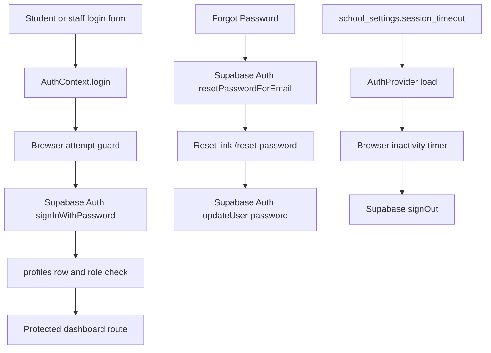

# Sprint B engineering journal — Security settings and truthful UX

Date: 8 October 2026

Scope: Admin Security settings and the shared authentication paths they describe

## Problem

The Admin Security card mixed implemented behavior with misleading presentation:

- email/password authentication and password reset were implemented, but their
  ownership was not stated clearly;
- Two-Factor Authentication appeared as a setting even though the application
  has no enrollment, challenge, verification, recovery, or enforcement flow;
- the selected session timeout is real, but the page did not explain when a
  newly saved value reaches the active authentication provider;
- the page said failed sign-ins were not limited, while `AuthContext` contained
  an incomplete browser counter that permanently blocked a browser after five
  failures and did not display its specific lockout message on either login
  page.

## Architecture

Authentication is a direct React-to-Supabase flow. The Node workspace does not
receive credentials or participate in sign-in.



`supabase-js` persists the session in tab-scoped `sessionStorage`, refreshes
tokens automatically, and reports session changes through
`onAuthStateChange`. The profile row supplies the role after authentication.

## Current Implementation

### Email/password and password reset

- Student and staff forms call the shared `AuthContext.login` function.
- Login calls `supabase.auth.signInWithPassword` directly.
- Password reset requests call `resetPasswordForEmail` with the current origin's
  `/reset-password` route.
- The reset page accepts a Supabase recovery session and calls
  `supabase.auth.updateUser({ password })`.
- Logout calls Supabase `signOut`, clears local authentication state, and leaves
  protected routes inaccessible.

### Session behavior

The Admin value is not decorative. `AuthContext` reads
`school_settings.session_timeout` when the provider mounts, converts minutes or
hours to milliseconds, and resets one inactivity timer on mouse, keyboard,
scroll, and touch activity. Expiry calls the shared logout function.

The live row was inspected read-only and currently contains `15 min`. A saved
change is persisted by Admin Settings, but an already-mounted provider does not
subscribe to that save. The active browser therefore uses the new value on the
next portal load. The Security card now states this timing.

### MFA and legacy settings columns

No MFA calls, factor enrollment, challenge/verify flow, assurance-level check,
or MFA policy enforcement exists in source. The live database has a legacy
`two_factor_auth` boolean, but no function, trigger, Edge Function, or
application path enforces it. The visible Two-Factor row was therefore removed.
The column was not dropped or rewritten during this frontend sprint.

The live `login_attempt_limit` boolean is also not an enforcement mechanism.
Admin Settings continues preserving legacy row values when it saves; Sprint B
does not perform schema work.

## Root Cause

The Security card treated schema fields and planned concepts as though each had
an operational feature behind it. Separately, the old attempt counter stored a
count in `localStorage` but no expiry. Its fifth failure became permanent for
that email in that browser. Login pages discarded `error.userMessage`, so the
specific protection message was replaced with a generic failure. The shared
login function also retried invalid credentials, causing two Supabase requests
for one user submission.

## Security Analysis

The exact five-attempt, 60-second pause is a browser-side abuse control. It
reduces accidental and scripted repeated submissions from that browser, but it
is not an account-wide security boundary because browser storage can be cleared
or bypassed. The UI says **this browser** for that reason.

Supabase Auth separately applies server-side rate limits to authentication
traffic. Project-specific server thresholds could not be verified from the
available project evidence, so the UI makes no numeric backend claim.

Implementing a global counter keyed only by an unauthenticated email address in
the database was rejected. Such an endpoint would let an attacker lock out
another person's account and would add unauthenticated writes, cleanup, clock,
and concurrency requirements. Enforcing exactly five attempts for 60 seconds
on the server would require an approved trusted authentication gateway or
equivalent server-side Auth extension. That architecture is outside this
sprint; the existing Supabase server protection remains in place.

Only Supabase `invalid_credentials` responses count toward the browser pause.
Network failures, profile-read failures, role mismatch, archived accounts, and
server rate limits do not punish a user as though the password were wrong. A
successful password authentication clears the sequence before later role and
profile checks.

## Alternatives Considered

| Option | Decision | Reason |
|---|---|---|
| Leave Two-Factor as “Not available” | Rejected | It still presents an unimplemented security concept as an Admin setting. |
| Add MFA during Sprint B | Rejected | Enrollment, recovery, challenge, enforcement, and database policy work would be a separate security feature. |
| Add a public database lockout counter | Rejected | It creates account-denial and unauthenticated-write risks without a trusted credential boundary. |
| Claim the legacy booleans enforce security | Rejected | No source, database routine, trigger, or Edge Function uses them for enforcement. |
| Keep the permanent local counter | Rejected | A temporary abuse control must recover automatically and communicate its state. |
| Browser pause plus existing Supabase rate limits | Selected | It fits the direct-client architecture, adds no privileged endpoint, and can be described truthfully. |

## Implementation

- Added a small login-attempt utility with normalized email keys, five counted
  incorrect credentials, a 60-second expiry, success clearing, safe storage
  failure behavior, and cleanup of legacy permanent locks.
- Stopped retrying invalid credentials and Supabase rate-limit responses.
- Preserved specific lockout/rate-limit messages on Student and Faculty login.
- Replaced the Security card's misleading rows with truthful Authentication
  Method, Session Timeout, and Sign-in Attempt Protection descriptions.
- Removed the visible Two-Factor Authentication row.
- Added focused unit and browser regression for attempt behavior, password-reset
  ownership, logout, and Security-card wording.

## Files Changed

- `frontend/src/lib/loginAttemptLimit.js`
- `frontend/src/lib/loginAttemptLimit.test.js`
- `frontend/src/context/AuthContext.jsx`
- `frontend/src/pages/auth/FacultyLogin.jsx`
- `frontend/src/pages/auth/StudentLogin.jsx`
- `frontend/src/pages/dashboards/admin/tabs/SettingsTab.jsx`
- `frontend/src/pages/dashboards/admin/tabs/SettingsTab.security.test.jsx`
- `e2e/security-auth.spec.js`
- `e2e/auth-pages.spec.js`
- `e2e/admin-settings.spec.js`
- `docs/sprint-b-security-journal.md`

## Impact Analysis

| Area | Affected | Explanation |
|---|---|---|
| Authentication | YES | Incorrect-password submissions now use an expiring browser pause and specific feedback. |
| Users | YES, shared login only | Student and staff login forms preserve the shared error message. Account data is unchanged. |
| Admin | YES | The Security card now states only implemented behavior. |
| Supabase | YES, existing APIs only | Existing password auth, recovery, update, sign-out, and server rate limiting remain. No configuration was changed. |
| Frontend | YES | One utility, shared login behavior, two error renderers, and Security copy changed. |
| Backend | NO | The Node workspace is not in the authentication path and was not changed. |
| Database | NO | Live rows were inspected read-only. No table, policy, function, trigger, or data changed. |
| Accessibility | YES, bounded | Existing alert regions now receive the specific protection message; no focus or name contract changed. |
| Responsive | YES, bounded | Security text changed inside the existing responsive row/card layout; no breakpoint or sizing rule changed. |
| Performance | NO material impact | Each submission performs constant-time storage reads/writes before the existing network work. |

## Complexity

Before: **O(1)** storage and authentication orchestration per login submission.

After: **O(1)** storage and authentication orchestration per login submission.

There is no algorithmic change. Storage remains one small record per normalized
email used in that browser.

## Verification

### Passed

Focused unit regression:

```text
npm run test --workspace frontend -- src/lib/loginAttemptLimit.test.js src/pages/dashboards/admin/tabs/SettingsTab.security.test.jsx
```

Result: **4 passed, 0 failed** in 6.08s. This covers the fifth-failure boundary,
60-second expiry, one-second countdown edge, email normalization, success
clearing, legacy permanent-lock cleanup, error classification, specific message
preservation, the live 15-minute UI value, truthful copy, and removal of the MFA
row.

Focused browser authentication regression:

```text
npx playwright test e2e/auth.spec.js --grep "student reaches|teacher reaches|wrong password|logging in"
```

Result: **4 passed, 0 failed** in 19.4s. Real Student and Teacher sign-in,
incorrect-password rejection, routing, and login duration passed.

Focused Sprint B browser regression:

```text
npx playwright test e2e/security-auth.spec.js e2e/auth-pages.spec.js --grep "five incorrect submissions|logout ends|reset request uses Supabase"
```

Result: **3 passed, 0 failed** in 9.0s. The reset request used Supabase Auth,
five submissions produced exactly five token requests before the browser pause,
and logout reached the application's `/login` route. The logout test also proved
that revisiting `/student-dashboard` after sign-out does not restore access.

Focused lint:

```text
npx eslint frontend/src/lib/loginAttemptLimit.js frontend/src/lib/loginAttemptLimit.test.js frontend/src/pages/dashboards/admin/tabs/SettingsTab.security.test.jsx frontend/src/pages/dashboards/admin/tabs/SettingsTab.jsx e2e/security-auth.spec.js e2e/auth-pages.spec.js e2e/admin-settings.spec.js
```

Result: **PASS**, no findings, in 5.79s. A wider touched-source check reproduced
the pre-existing AuthContext/login findings already outside this sprint's
focused lint set; Sprint B added no suppression.

Production build:

```text
npm run build --workspace frontend
```

Result: **PASS**, 1,502 modules transformed in 11.36s. The existing large-chunk
advisory remains; Sprint B added no dependency.

### Source and live read-only verification

- VERIFIED: session storage, token refresh, auth-state listener, password auth,
  password reset, password update, logout, role lookup, and inactivity timer
  paths were traced in current source.
- VERIFIED: the live `school_settings.session_timeout` value is `15 min`.
- VERIFIED: live legacy Two-Factor and login-attempt booleans have no matching
  database routine, trigger, Edge Function, or application enforcement path.
- NOT VERIFIED: the deployed Supabase project's exact server rate-limit values;
  only the existence of Supabase Auth server rate limiting is asserted.

### Blocked Admin visual verification

The focused Admin Security browser test was attempted, but the configured Admin
fixture did not reach `/admin-dashboard` and timed out after 30 seconds. The
failure occurred in the shared login helper before Settings rendered.

Therefore live Admin inspection at 360, 390, 768, 1024, and 1440px and in light
and dark themes remains **NOT VERIFIED** in Sprint B. The change uses the
existing Settings rows, badge, typography, tokens, and breakpoints, and focused
render tests pass, but those facts do not replace visual browser evidence.
Restore a valid `E2E_ADMIN_EMAIL` / `E2E_ADMIN_PASSWORD` fixture and run the
existing Admin Settings matrix during Manual QA.

## Regression Risk

**LOW to MEDIUM.** The data model, Supabase client configuration, session timer,
password-reset mechanics, and dashboard routing were not rewritten. The shared
login path changed, but real Student/Teacher login and focused failure/lockout
cases passed. Risk remains above LOW because the Admin responsive/theme matrix
is blocked by the rejected fixture and the exact pause is intentionally local
to one browser.

## Sprint B Release Notes

Resolved:

- Removed the misleading Admin Two-Factor setting.
- Documented the implemented email/password, Supabase reset, and inactivity
  timeout behavior directly in the Security card.
- Replaced the permanent local failure state with five consecutive incorrect
  credentials followed by a 60-second browser pause.
- Preserved specific lockout and Supabase rate-limit feedback on both login
  pages and stopped duplicate retries for deterministic authentication errors.

No MFA feature, authentication gateway, schema migration, or Supabase project
configuration was introduced.

## Future Work

- A future MFA project must include enrollment, factor management, recovery,
  challenge/verify, assurance-level enforcement, and matching RLS decisions.
- A globally enforced numeric lockout requires a trusted server-side
  authentication boundary and resistance to account-denial attacks.
- The separate Supabase E2E environment and a valid Admin fixture remain the
  correct prerequisites for reliable Admin visual/security regression.
- Sprint C was not started.
