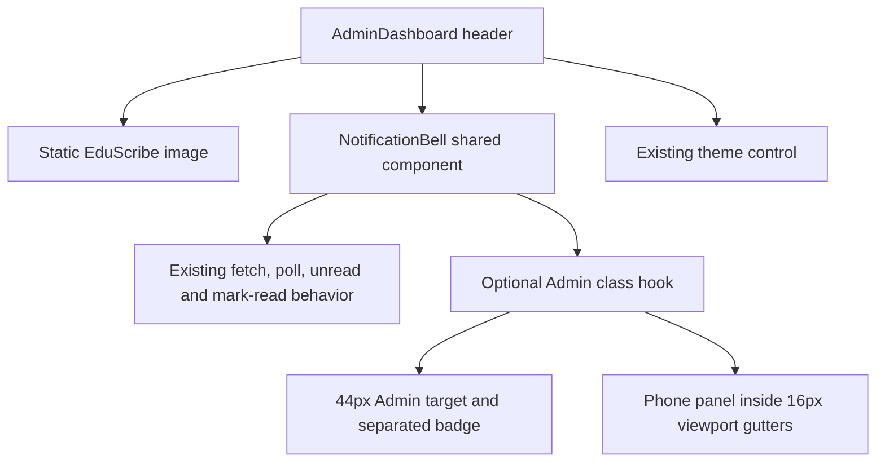

# Sprint C engineering journal — Visual polish and mobile experience

Date: 8 October 2026

Scope: Admin Dashboard header, notification presentation, product branding, and
minor responsive shell defects only

## Problem

Sprint C addressed three visible Admin Dashboard issues:

1. The 18px unread badge was positioned at the top-right inside a 40px bell
   button. Its box intersected the centered 18px bell glyph. The bell was also
   the only Admin header action below the dashboard's established 44px mobile
   target floor.
2. The Admin header used `FlippingLogo`, alternating the EduScribe mark with the
   school seal during navigation instead of presenting stable product branding.
3. Responsive verification found the notification dropdown started 36px beyond
   the left viewport edge at 360px. Its maximum width was responsive, but it
   remained right-anchored to the bell, so the width cap alone could not contain
   it.

No other genuine header-shell overlap, clipping, action wrapping, or horizontal
overflow was reproduced at 360, 390, 768, 1024, or 1440px in either theme.

## Root Cause

`NotificationBell` used `top-0 right-0` for its count inside a 40px relative
button. The badge and glyph therefore occupied some of the same coordinates.
Admin's mobile target rules covered `.nav-menu-btn` and `.nav-toggle-btn`, but
the shared notification button had no stable class hook and retained its 40px
Tailwind size.

The dropdown used `right: 0` relative to the bell with a viewport-based maximum
width. At 360px the bell is not at the viewport's right edge because the theme
button follows it; the 328px panel consequently extended left of the screen.

The header directly mounted `FlippingLogo`, whose inner element runs the global
coin-flip animation and renders a second back face. The official static
`/EduScribeLogoIcon.png` asset already existed and the Admin header already had
an image sizing rule for a 64px mark.

## Architecture



The Admin shell continues to own header layout and breakpoints.
`NotificationBell` continues to own all notification state and Supabase calls.
The shared component gained only stable class names and an optional outer class;
its data flow, polling, open state, and mutations are unchanged.

## Component Relationships

- `AdminDashboard` renders the product mark, `NotificationBell`, theme control,
  navigation drawer, and main shell.
- `NotificationBell` reads the authenticated user from `AuthContext`, loads the
  user's notifications from Supabase, and renders its existing dropdown.
- Admin-specific CSS scopes the 44px target, badge offset, and phone panel
  containment through `admin-notification-bell`.
- Other dashboards still consume the shared bell without that Admin class, so
  their layout is not silently changed by this sprint.
- `FlippingLogo` remains available to non-Admin screens. Sprint C does not
  redefine a shared brand component outside its approved scope.

## Design Decisions

### Notification bell

The Admin bell is 44px by 44px. The badge moves just beyond the glyph while
remaining inside the header action group and before the theme control. Its
18px minimum size, red surface, white text, `9+` cap, and two-pixel navy edge
remain unchanged.

On phones, the existing dropdown uses fixed positioning with the same 16px
left and right gutters as the Admin page. Its content, radius, shadow, theme
tokens, list behavior, and open/close behavior remain unchanged.

### Branding

The Admin header now renders `/EduScribeLogoIcon.png` directly with the existing
64px sizing, circular crop, alignment, and accessible `EduScribe` alternative
text. The adjacent EduScribe/Admin Portal wordmark is unchanged.

### Responsive polish

The implementation preserves the 1024px drawer breakpoint, 76px header height,
existing navigation order, 8px action gap, typography, colors, radii, and
shadows. The responsive test measures layout geometry rather than relying on a
screenshot alone.

## Alternatives Rejected

| Alternative | Reason rejected |
|---|---|
| Shrink or hide the unread badge | Loses visibility and would not correct the positioning cause. |
| Reduce the badge text below the established size | Reintroduces the earlier legibility defect. |
| Move or stack all header actions | Redesigns a header that otherwise fits the requested widths. |
| Change `FlippingLogo` globally | Would alter authentication and non-Admin dashboards outside Sprint C. |
| Apply the 44px bell and phone panel globally | The task is Admin-scoped; other dashboard headers need their own verification before layout changes. |
| Add another CSS override without component hooks | Would depend on Tailwind class strings and make ownership unclear. Stable semantic classes are smaller and safer. |

## Implementation

- Added semantic `notification-bell`, `notification-bell-button`,
  `notification-badge`, and `notification-panel` class hooks to the shared bell.
- Added an optional outer `className` without changing the component's default
  appearance or behavior.
- Scoped Admin bell sizing and badge placement to `admin-notification-bell`.
- Contained the Admin phone dropdown within the existing 16px viewport gutters.
- Replaced the Admin header's `FlippingLogo` instance with the official static
  EduScribe image.
- Updated the existing unread-count style probe for the semantic badge class.
- Added a read-only Admin-shell browser fixture and a five-width, two-theme
  geometry regression.

## Files Changed

- `frontend/src/components/NotificationBell.jsx`
- `frontend/src/pages/dashboards/admin/AdminDashboard.jsx`
- `e2e/admin-header-polish.spec.js`
- `e2e/text-size.spec.js`
- `docs/sprint-c-visual-polish-journal.md`

## Impact Analysis

| Area | Affected | Explanation |
|---|---|---|
| Header | YES | Static logo and corrected bell geometry. Header height and order remain. |
| Navigation | YES, verification only | Drawer breakpoint, menu visibility, and non-overlap were measured; navigation behavior did not change. |
| Notifications | YES, presentation only | Target, badge position, and phone panel containment changed; data behavior did not. |
| Branding | YES | Admin uses the official static EduScribe asset. |
| Responsive | YES | The phone panel and header geometry now fit every requested width. |
| Accessibility | YES | Admin bell meets the 44px target floor; the decorative Bell glyph is hidden from the accessible name. Existing button name remains. |
| Performance | NO material impact | One continuous logo animation and its second face are no longer mounted in Admin. Layout remains constant time. |
| Shared Components | YES, compatible | NotificationBell gained optional styling hooks; existing consumers retain defaults. |
| Theme | YES, verified | Existing tokens remain; layout passed in light and dark modes. |

## Complexity

Before: **O(1)** header layout and notification rendering, excluding the
unchanged O(n) notification list render.

After: **O(1)** header layout and notification rendering, excluding the same
unchanged O(n) notification list render.

There is no algorithmic change.

## Verification

### Responsive and theme matrix

The focused browser regression checked 360, 390, 768, 1024, and 1440px in both
light and dark themes. It asserted:

- the official static asset is the only Admin header logo;
- no `.eduscribe-flip` element exists in the Admin brand;
- the logo remains 64px by 64px;
- the notification target remains at least 44px by 44px;
- the badge does not intersect the bell glyph or theme control;
- the badge stays inside the viewport;
- the 76px header height remains unchanged;
- header actions do not wrap;
- brand and action groups do not overlap;
- the menu appears below 1024px and is hidden from 1024px upward;
- the closed drawer completes its existing off-canvas transition;
- the document and header have no horizontal overflow;
- the 360px notification panel remains inside the viewport.

Representative 360px and 1440px light/dark screenshots were attached to the
Playwright report and inspected. The static logo, badge separation, header
alignment, themes, cards, and mobile layout rendered consistently.

### Targeted browser regression

```text
npx playwright test e2e/admin-header-polish.spec.js e2e/text-size.spec.js --grep "Admin header|unread count"
```

Result: **2 passed, 0 failed** in 15.7s. This covered Admin layout plus the
existing badge font-size, contrast, and `9+` sizing contract.

The final screenshot-producing header run also passed: **1 passed, 0 failed**
in 9.4s.

### Focused lint

```text
npx eslint frontend/src/components/NotificationBell.jsx frontend/src/pages/dashboards/admin/AdminDashboard.jsx e2e/admin-header-polish.spec.js e2e/text-size.spec.js
```

Result: **PASS**, no findings, in 5.18s.

### Production build

```text
npm run build --workspace frontend
```

Result: **PASS**, 1,502 modules transformed in 17.27s. The existing large-chunk
advisory remains; Sprint C added no dependency.

The first sandbox build attempt could not start esbuild (`spawn EPERM`). The
approved outside-sandbox rerun completed successfully.

### Test fixture boundary

The configured Admin credential remains rejected. To keep visual verification
read-only, the new test first creates a real seeded Student Supabase session,
then intercepts only the browser's profile response to render the Admin shell as
`main_admin`. Notification GET/PATCH requests are also intercepted. No role,
notification, database row, policy, or production configuration is changed.

This fixture verifies the actual compiled Admin components and styles. It does
not claim to verify live Admin authorization or Admin data access; those remain
part of Manual QA with a valid Admin fixture.

## Regression Risk

**LOW.** The production change is one static image substitution, optional class
hooks, and small Admin-scoped layout rules. Notification fetching, polling,
mark-read behavior, navigation state, breakpoints, themes, and database access
are unchanged. Risk is bounded further by geometry assertions, visual captures,
badge legibility coverage, focused lint, and the production build.

## Sprint C Release Notes

- Separated the Admin unread badge from the bell icon while preserving its
  visibility and increasing the bell to the established 44px target.
- Replaced the animated Admin header logo with the official static EduScribe
  mark.
- Kept the notification dropdown within phone viewport gutters and verified the
  Admin header across five widths in light and dark themes.

## Future Notes

- Other dashboards and authentication pages still use `FlippingLogo`; changing
  their branding requires an explicitly broader scope and their own regression.
- Live Admin authorization and data remain dependent on a valid Admin E2E
  fixture or the planned separate Supabase E2E environment.
- Backup & Logs and Email Notifications were not redesigned.
- Sprint D was not started.
