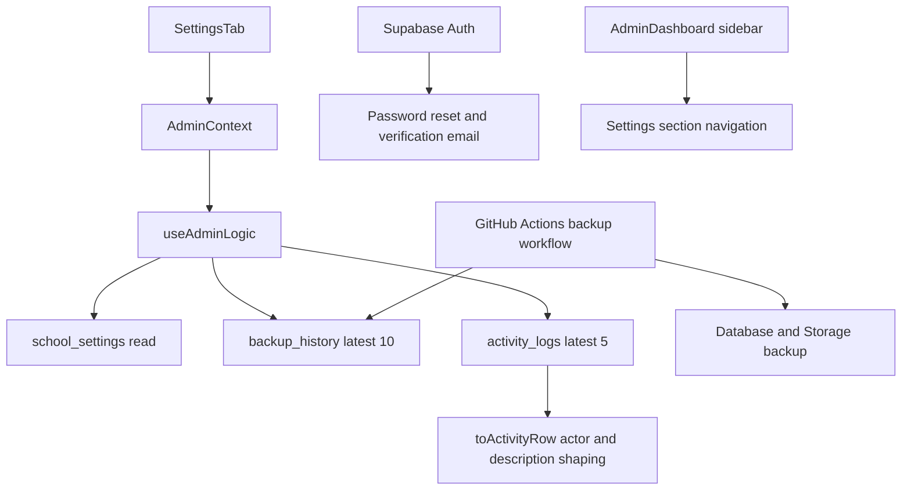

# Sprint D engineering journal — System Settings completion

Date: 8 October 2026

Scope: Admin Dashboard System Settings only — portal email information,
backup information and history, recent administrative activity, and Settings
section navigation

## Problem

The Settings page mixed accurate implementation details with presentation that
still looked provisional:

1. Portal email delivery was correctly described as absent, but a `Not
   available` badge made the row read like a disabled future control.
2. The Backup card did not say what was backed up or how long downloadable
   artifacts remain available. Its history was a flat date/status string even
   though real workflow records exist.
3. The activity history omitted the actor and description already supplied by
   the shared activity-log shaping layer, leaving a flat action/date string.
4. Retention and language copy used future-looking wording such as “not
   available yet” and “nothing else to choose yet.”
5. Focused mobile verification found that Settings section links closed the
   navigation drawer but failed to move the page to the chosen section.

## Root Cause

The Settings UI originally exposed database fields as controls before their
values had product behavior. Earlier work removed those inert controls, but a
few placeholder labels and terse history renderers remained.

Backup ownership was also not visible in the UI. The actual scheduled operation
lives in `.github/workflows/supabase-backup.yml`, outside the Settings form. It
runs at `30 16 * * *` UTC (12:30 AM Manila), dumps the PostgreSQL database,
downloads uploaded Supabase Storage files, records its result in
`backup_history`, and retains the downloadable GitHub Actions artifact for
seven days. The Settings row cannot configure that workflow.

Activity rows were already shaped by `toActivityRow` with `action`, `message`,
`actorName`, and `created_at`, but Settings rendered only the first and last
fields.

On mobile, the drawer's scroll lock restored the captured page position during
cleanup. The section click called `scrollIntoView()` while that lock was still
active, then closing the drawer restored the previous position and cancelled
the visible jump.

## Architecture



- `SettingsTab` owns the visible descriptions and history presentation.
- `useAdminLogic` continues to own Settings reads, editable Settings state, and
  the existing backup/activity collections.
- GitHub Actions owns automated backup execution and artifact retention.
- Supabase Auth owns authentication email. No portal service sends
  announcement, memo, calendar, or activity email.
- `AdminDashboard` owns the desktop sidebar/mobile drawer and its scroll lock.

No backend route or application email service exists for these Settings rows.
No database value was changed during Sprint D.

## Component Relationships

- The General, Security, Notifications, Backup & Logs, and Appearance sections
  remain sections of the existing `SettingsTab`.
- `school_settings` still supplies Academic Year, Quarter, and Session Timeout.
  Legacy email/backup/retention columns remain preserved by the current load and
  save path for compatibility, but the UI does not claim that they enforce
  behavior.
- `backup_history` supplies the latest ten workflow records.
- `activity_logs`, joined to `profiles`, supplies the latest five actions; the
  shared mapper provides a truthful actor label even for archived or removed
  profiles.
- The Settings sidebar invokes the existing `scrollToSection` function after
  the mobile drawer has released its document scroll lock.

## Decision Log

### Portal email notifications

The row is an informational statement rather than a disabled control. It names
the four portal content types that do not generate email and separately states
that password reset and verification email are handled by Supabase Auth. The
`Not available` badge was removed because it suggested unfinished interactive
functionality.

### Backup

The card describes the real scheduled workflow, its daily Manila schedule, the
database and uploaded-storage scope, external ownership, and seven-day artifact
retention. A compact `Daily` badge summarizes cadence without suggesting the
value can be changed here.

History uses a labelled semantic list with one grouped item per workflow run.
Each item has a stable operation label, formatted timestamp, and status badge.
Unknown workflow statuses receive a neutral badge and safe text rather than
causing rendering failure.

### Administrative activity

The panel is labelled `Recent Admin Activity` and states its five-row limit.
Each semantic list item shows the action, optional description, actor, and
timestamp. The panel follows the existing overview loading state instead of
using the unrelated Settings/backup loading state.

### Retention and language

Activity retention now states the implemented fact: logs are kept indefinitely
and no automated retention policy exists. The legacy `90 days` database value
is not presented as enforcement because no cleanup reader, job, or deletion
path was found. Language now states that the interface is available in English
only, without future-product wording.

### Mobile section navigation

Desktop section navigation remains immediate. When the drawer is open, the
handler closes it first and schedules the existing section scroll for the next
animation frame, after React runs the scroll-unlock cleanup.

## Alternatives Rejected

| Alternative | Reason rejected |
|---|---|
| Add email toggles or delivery | No portal email sender exists; this would expose unsupported behavior and exceed Sprint D. |
| Add backup controls | The workflow schedule is source-controlled outside the portal; a UI control would be fake without new infrastructure. |
| Implement backup or retention infrastructure | Explicitly outside scope and unnecessary because the backup workflow already operates. |
| Display the legacy `90 days` retention value | No cleanup process enforces it, so presenting it would be misleading. |
| Keep histories as flat strings | Omits existing context and fails the requested hierarchy/readability improvement. |
| Redesign Settings cards | Existing cards and tokens already support the required hierarchy; a redesign would add risk without correcting capability truth. |
| Remove mobile section links | The links are useful and the ordering defect had a small local fix. |

## Implementation

- Replaced placeholder-like portal email wording with a direct capability
  statement and removed the `Not available` badge.
- Documented the actual daily database/storage backup and seven-day artifact
  retention without adding a control.
- Replaced future-looking activity-retention and language wording.
- Rendered labelled backup and activity lists with clearer grouping, metadata,
  and status treatment using existing Admin tokens.
- Added focused loading/empty wording for each history panel.
- Corrected mobile Settings section navigation sequencing around the existing
  drawer scroll lock.
- Added component regression coverage and a read-only five-width, two-theme
  browser regression. Updated the existing Settings truthfulness expectation.

## Files Changed

- `frontend/src/pages/dashboards/admin/tabs/SettingsTab.jsx`
- `frontend/src/pages/dashboards/admin/AdminDashboard.jsx`
- `frontend/src/pages/dashboards/admin/tabs/SettingsTab.security.test.jsx`
- `frontend/src/pages/dashboards/admin/tabs/SettingsTab.completion.test.jsx`
- `e2e/admin-settings.spec.js`
- `e2e/admin-settings-completion.spec.js`
- `docs/sprint-d-system-settings-journal.md`

## Impact Analysis

| Area | Affected | Explanation |
|---|---|---|
| Settings | YES | Capability wording, history presentation, and mobile section navigation were completed. |
| Security | NO behavior change | Existing truthful authentication/session information remains; Supabase Auth ownership is stated accurately. |
| Email | YES, informational only | Portal-email absence and Supabase Auth email ownership are now explicit. No sender was added. |
| Backup | YES, presentation only | The real workflow scope, cadence, retention, and recorded runs are clearer. Execution is unchanged. |
| Logs | YES, presentation only | Existing action, description, actor, and time are grouped and labelled. Data reads are unchanged. |
| Accessibility | YES | History groups are labelled semantic lists; status remains visible text; existing form labels remain. |
| Responsive | YES | New grouped items wrap safely and the mobile section links now reach their targets. |
| Performance | NO material impact | The same bounded ten backup and five activity rows are rendered. |
| Shared Components | NO | No shared UI component changed. |
| Backend | NO | No endpoint, service, workflow, or script changed. |
| Database | NO | No schema, query shape, policy, migration, or data changed. |

## Complexity

Before: **O(1)** Settings sections plus bounded O(10) backup and O(5) activity
renders.

After: **O(1)** Settings sections plus the same bounded O(10) and O(5) renders.

There is no algorithmic change.

## Verification

### Source and live read-only evidence

- The backup workflow schedules the database/storage operation daily and keeps
  artifacts for seven days.
- Source search found Supabase Auth reset/verification flows but no portal
  content-email sender or provider integration.
- Source search found no activity-log cleanup or retention job.
- A read-only live query confirmed that `backup_history` and `activity_logs`
  contain real records (37 and 59 respectively at verification time). It also
  confirmed the legacy `activity_logs_retention` value exists, but source
  evidence does not show it being enforced.

### Component regression

```text
npm test -- --run src/pages/dashboards/admin/tabs/SettingsTab.security.test.jsx src/pages/dashboards/admin/tabs/SettingsTab.completion.test.jsx
```

Final result: **3 passed, 0 failed** across two files in 4.36s. Coverage includes
authentication truthfulness, portal email wording, backup scope/retention,
absence of placeholder switches/phrases, semantic histories, status labels,
activity description, and actor identity.

The first sandbox attempt did not start Vitest because Windows denied the
esbuild child process (`spawn EPERM`). The approved outside-sandbox rerun
completed successfully.

### Responsive, theme, and navigation regression

```text
npx playwright test e2e/admin-settings-completion.spec.js --project=chrome
```

Final result: **1 passed, 0 failed** in 10.0s (7.9s test time).

The read-only browser regression checked 360, 390, 768, 1024, and 1440px in
both light and dark themes. It verified truthful text, absence of fake switches
and placeholder phrases, Backup and Recent Activity lists, safe long-label
wrapping, card/item/document overflow, desktop Backup & Logs navigation, and
mobile Notifications navigation. Representative 360px light and 1440px dark
screenshots were attached to the Playwright report and inspected.

The first browser run exposed the real mobile section-navigation ordering bug.
After the focused fix, the complete matrix passed.

The fixture signs in with the seeded Student account, then modifies only
browser responses to render the real Admin shell with deterministic Settings,
backup, and activity data. Non-GET activity/settings routes are blocked. No
database role, setting, log, backup record, policy, or production configuration
is changed. Live Admin authorization remains for Final QA with a valid Admin
account.

### Focused lint

```text
npx eslint frontend/src/pages/dashboards/admin/AdminDashboard.jsx frontend/src/pages/dashboards/admin/tabs/SettingsTab.jsx frontend/src/pages/dashboards/admin/tabs/SettingsTab.security.test.jsx frontend/src/pages/dashboards/admin/tabs/SettingsTab.completion.test.jsx e2e/admin-settings.spec.js e2e/admin-settings-completion.spec.js
```

Result: **PASS**, no findings, in 8.27s.

### Production build

```text
npm run build --workspace frontend
```

Result: **PASS**, 1,502 modules transformed in 9.89s. The existing large-chunk
advisory remains; Sprint D added no dependency.

The credential-dependent cases in `e2e/admin-settings.spec.js` were not run
because the configured Admin fixture remains rejected and write persistence is
outside this read-only pass. Their updated truthfulness assertions will run
with that fixture during Manual/Final QA.

## Regression Risk

**LOW.** Production changes are text, bounded history markup/styles, and one
drawer-scroll ordering correction. Existing reads, saves, workflows,
authentication, themes, breakpoints, and database behavior remain. Focused
component, browser, lint, and build verification bound the affected surface.

## Sprint D Release Notes

- Replaced placeholder-like Email Notifications presentation with truthful
  portal-email and Supabase Auth ownership information.
- Clarified the operational database/storage backup schedule and seven-day
  artifact retention without exposing unsupported controls.
- Improved Backup History and Recent Admin Activity hierarchy, grouping,
  labels, metadata, and responsive wrapping.
- Removed future-looking retention and language wording.
- Corrected Settings section navigation from the mobile drawer.

## Future Work

- A portal-managed email delivery service would require a separately approved
  architecture, provider, templates, consent/delivery policy, and backend
  enforcement before any toggle can be exposed.
- Backup schedule or retention controls would require secure workflow
  orchestration outside the current frontend-only Settings ownership.
- Automated activity retention would require a defined policy and database-side
  cleanup mechanism before the legacy value can become a user-facing setting.
- Final QA remains pending. Sprint D does not begin it.
