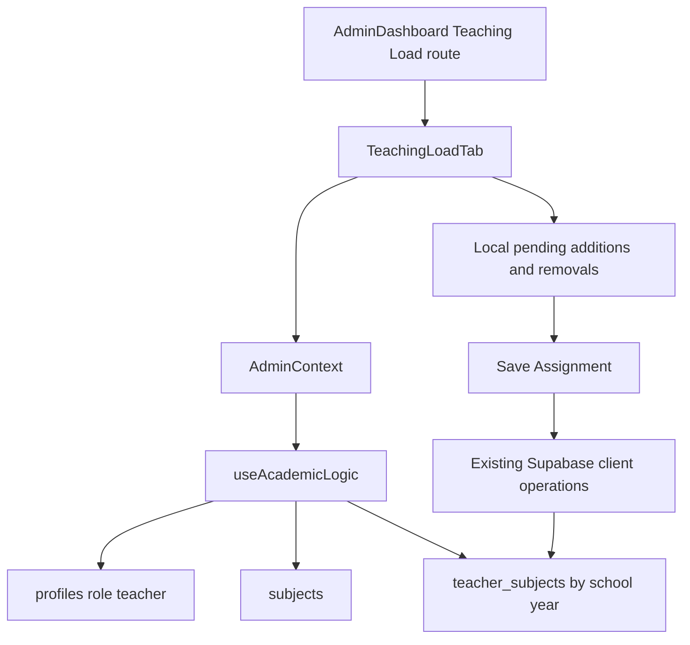

# UX-01 engineering journal — Teaching Load overhaul

Date: 9 October 2026

Scope: Admin Dashboard Teaching Load only

## Problem

The previous Teaching Load workflow split one assignment task across a teacher
picker, subject picker, detached draft list, Assign action, and separate saved
table. The selected teacher and grade were easy to lose while reviewing the
draft. The UI also disabled a teacher after one assignment and disabled a
subject after another teacher used it in the grade, even though the persisted
rule permits both cases.

Removing a saved row happened immediately, while additions were staged. That
made one visible editor use two different save models and made it difficult to
understand which changes were pending.

## Root Cause

The screen was organized around building rows rather than managing one
teacher's load. Presentation-only restrictions had also become stricter than
the data rule.

The migration source defines uniqueness as
`(teacher_id, subject_id, grade_level, school_year)`. The existing upsert uses
that same conflict target. Therefore, only the exact teacher, subject, grade,
and year tuple is a duplicate. A teacher may hold multiple subjects in one
grade, and multiple teachers may hold the same subject.

## Architecture



- `AdminDashboard` owns the existing Admin shell and the local Teaching Load
  CSS rules.
- `TeachingLoadTab` owns selection, search, grade context, working rows, dirty
  state, duplicate feedback, and the save experience.
- `useAcademicLogic` continues to own Supabase reads and writes. It fetches
  teachers, subjects, and the selected school year's `teacher_subjects` rows.
- `AdminContext` continues to expose that state and those operations to the
  tab.
- Schedules continue to consume persisted teaching-load rows through their
  existing path. No Schedule code or data contract changed.

No backend route, schema, migration, RLS policy, or database data changed.

## Component Relationships

The screen retains the existing School Year toolbar and grade tabs. Below
them, a two-panel workspace provides one continuous task:

1. Search and select a teacher in the left panel.
2. Keep the selected teacher, department, account status, grade, and subject
   count visible in the right panel.
3. Review assigned subjects as removable chips.
4. Add another active subject directly to the same working list.
5. Save or discard the combined additions and removals.

At widths below 1200px the panels stack. This breakpoint accounts for the
Admin sidebar at 1024px and prevents the minimum detail width from widening the
document. Mobile controls retain the existing Admin card, token, type, radius,
and button language.

## UX Decisions

### Teacher-centred context

The teacher is the primary selection. Changing grades keeps that teacher
selected, so the admin can review the same person's load across grade levels.
Counts beside each teacher and grade include staged changes.

### One working list

Saved and newly added subjects share one chip list. New chips are identified as
`New`; removing either kind updates the local working state. Saved removals do
not reach Supabase until Save Assignment.

### Duplicate rule

The UI blocks only an exact duplicate for the selected teacher and grade. The
message names the subject, teacher, and grade. It does not prevent another
teacher from receiving that subject or the selected teacher from receiving a
different subject.

### Save state

The persistent save bar reports either `Unsaved changes` with an exact count or
`All changes saved`. Save uses the existing batch upsert for additions and one
bounded delete for staged removals. A failed operation leaves the unsaved state
visible for retry.

While changes are staged, School Year and Copy from Previous Year are locked
with an explanation. This prevents entries staged under one year from being
written under another year. Grade and teacher navigation remain available
because each staged entry carries its own grade and teacher identifiers.

### Accessibility and input behavior

- Teacher rows are buttons with `aria-pressed` selection state.
- Search, subject selection, status, errors, assigned subjects, and save state
  have programmatic labels or live semantics.
- Removing a chip restores focus to a remaining remove control or a stable
  subject heading.
- Feature controls maintain at least 44px height in the tested mobile layouts.
- The initial search focus is limited to desktop fine-pointer environments.

## Alternatives Rejected

| Alternative | Reason rejected |
|---|---|
| Preserve the detached draft table | It keeps the teacher and persisted result separated from the action being reviewed. |
| Save every add or remove immediately | It removes the requested review step and preserves the previous mixed save model. |
| Disable a teacher after one subject | It contradicts the tuple uniqueness rule and the approved multi-subject workflow. |
| Disable a subject after one teacher uses it | It prevents valid shared-subject assignments without database support for that restriction. |
| Add a new API or database table | Existing operations and schema already represent the required data safely. |
| Refactor shared Admin components | Existing buttons, tabs, context, and tokens support this workflow; broader changes would increase scope and regression risk. |

## Implementation

- Rebuilt `TeachingLoadTab` around teacher search and selection, a persistent
  teacher summary, one subject-chip work area, and direct subject addition.
- Added staged removal, combined dirty-state counts, discard, save feedback,
  exact duplicate validation, failure retention, and school-year integrity.
- Extended the teacher read with the existing `status` field for the visible
  selected-teacher summary.
- Extended `removeLoad` to accept one ID or a bounded ID list while preserving
  its original single-ID call shape. UX-01 can defer refresh until its combined
  save completes, avoiding competing refreshes.
- Replaced obsolete Teaching Load CSS with feature-scoped two-panel,
  responsive, chip, summary, error, and save-bar rules using existing tokens.
- Replaced the focused component tests and added a read-only/in-memory browser
  regression. Updated two existing Teaching Load E2E selectors and actions to
  match the released workflow.

## Files Changed

- `frontend/src/pages/dashboards/admin/tabs/TeachingLoadTab.jsx`
- `frontend/src/pages/dashboards/admin/useAcademicLogic.jsx`
- `frontend/src/pages/dashboards/admin/AdminDashboard.jsx`
- `frontend/src/pages/dashboards/admin/tabs/TeachingLoadTab.test.jsx`
- `e2e/admin-teaching-load-overhaul.spec.js`
- `e2e/admin-mobile-rows.spec.js`
- `e2e/admin-double-click.spec.js`
- `docs/ux-01-teaching-load-overhaul.md`

## Impact Analysis

| Area | Affected | Explanation |
|---|---|---|
| Teaching Load | YES | The assignment workflow, local working state, responsive presentation, and focused tests changed. |
| Teachers | YES, read/presentation only | The existing `status` column is included in the teacher read and displayed in the summary. |
| Schedules | NO code change | Schedules continue to consume the same persisted `teacher_subjects` records. |
| Admin Dashboard | YES, scoped CSS only | The shell is unchanged; its existing style block owns the replacement Teaching Load rules. |
| Shared Components | NO | No shared component implementation changed. |
| Accessibility | YES | Selection state, labels, live save state, focus restoration, and mobile targets were verified. |
| Responsive | YES | The workspace stacks below 1200px and was checked at all required widths. |
| Performance | YES, bounded improvement | Additions remain one batch upsert; multiple removals use one delete request instead of one request per chip. |
| Backend | NO | No backend service or route changed. |
| Database | NO | No schema, migration, policy, or data changed. |

## Complexity

Before and after rendering are **O(T + L + S)** for teachers, teaching-load
rows, and subjects. Search is **O(T)** and the selected assignment projection
is **O(L)**. The overhaul changes the interaction structure, not its
asymptotic cost.

Saving additions remains one batch upsert. Staged removals use one delete with
a bounded ID set, followed by the existing refresh. A combined save therefore
uses at most two write requests plus the existing read refresh, rather than a
request per removed chip.

## Verification

### Component regression

```text
npm run test --workspace frontend -- TeachingLoadTab.test.jsx --run
```

Result: **12 passed, 0 failed** in 6.23s. Coverage includes initial guidance,
teacher context, department search, multi-subject assignment, shared subjects,
exact duplicates, staged removals, batch additions, failed saves, grade
changes, school-year integrity, and read errors.

The sandboxed first attempt could not launch esbuild (`spawn EPERM`). The same
focused command passed when allowed to launch its local subprocess.

### Browser regression

```text
npx playwright test e2e/admin-teaching-load-overhaul.spec.js
```

Result: **1 passed, 0 failed** in 8.7s. The fixture signs in through the
existing seeded test flow, changes the browser-visible profile to an Admin,
and intercepts Teaching Load reads and writes in memory. It does not mutate the
live database.

Verified behavior:

- teacher search and keyboard selection;
- persistent teacher and grade context;
- multiple subjects for one teacher;
- exact duplicate feedback;
- staged removal and focus restoration;
- Save Assignment and school-year locking;
- grade switching after save;
- 360, 390, 768, 1024, and 1440px;
- light and dark themes;
- one/two-column breakpoints, touch targets, document overflow, workspace
  overflow, and unclipped child content.

Light 360px and dark 1440px screenshots were captured by the test and visually
inspected. The stacked mobile cards and desktop two-panel layout were clear,
aligned, and unclipped.

### Lint and build

```text
npx eslint frontend/src/pages/dashboards/admin/tabs/TeachingLoadTab.jsx frontend/src/pages/dashboards/admin/tabs/TeachingLoadTab.test.jsx frontend/src/pages/dashboards/admin/AdminDashboard.jsx e2e/admin-teaching-load-overhaul.spec.js e2e/admin-mobile-rows.spec.js e2e/admin-double-click.spec.js
npx eslint frontend/src/pages/dashboards/admin/useAcademicLogic.jsx --rule "react-hooks/set-state-in-effect: off"
```

Focused ESLint passed for the changed component, tests, Admin CSS owner, and
updated E2E files. `useAcademicLogic.jsx` also passed with only the existing
repository-baseline `react-hooks/set-state-in-effect` rule disabled; the five
known findings for its existing fetch effects are unrelated to UX-01. The two
focused lint commands completed in 11.04s.

```text
npm run build --workspace frontend
```

The frontend production build passed in 8.62s after the final implementation.
Its only note was the repository's existing bundle-size advisory.

Credential-dependent broad Admin E2E suites were not run. Their Teaching Load
selectors were updated, while the new isolated browser test provides the
requested UX-01 behavior, responsive, theme, focus, and no-write coverage.

## Release Notes

### UX-01

- Reorganized Teaching Load around a selected teacher with persistent grade
  and assignment context.
- Added direct multi-subject assignment, removable chips, exact-duplicate
  feedback, and a unified Save Assignment state.
- Preserved the existing data model while allowing valid multi-subject and
  shared-subject assignments.
- Added focused responsive, theme, keyboard, focus, and regression coverage.

## Future Enhancements

- A repository-level authenticated Admin E2E fixture would let the updated
  shared mobile and double-click suites run without depending on external
  credentials or live teaching-load data.
- An Admin-wide dirty-navigation contract could protect staged edits when a
  user leaves the Teaching Load tab. That behavior belongs to the shell and is
  outside UX-01.

UX-02 was not started.
