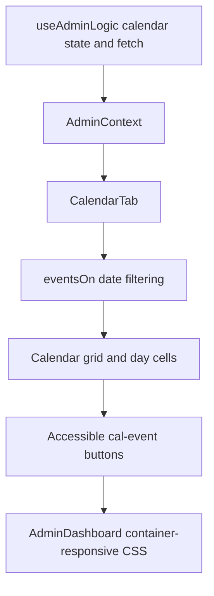

# L2 engineering journal — calendar chip wrapping

Date: 8 October 2026  
Scope: Admin Dashboard L2 only

> **Release continuity:** L2 is complete. Later checkpoint language in this
> journal is preserved as history; L3, L4, and RC1–RC3 were subsequently
> completed. See [admin-dashboard-release-summary.md](admin-dashboard-release-summary.md).

## Problem

At calendar-grid widths around 768px and 1024px, each of the seven day
columns is about 100px wide. Event names such as “Midterm Examinations” and
“School Foundation Day” were limited to two lines, so their final characters
were visually clipped. The complete title remained available through the
button's accessible name and `title`, but the normal visual presentation was
unnecessarily incomplete.

The issue does not apply below 768px because the approved responsive design
replaces the month grid with the agenda. Wide desktop calendars have enough
space to keep the established two-line density.

## Root Cause

The base `.cal-event` rule applied `-webkit-line-clamp: 2` at every visible
grid width. Viewport width cannot identify the affected layout reliably:
at a 1024px viewport, the fixed navigation sidebar leaves the calendar less
content width than the drawer layout leaves at 768px.

The calendar already solves this distinction with `.cal-page` as an inline-size
container and an existing `@container (max-width: 845px)` layout rule. The
missing part was a chip-specific clamp within that same content-width range.

## Component Relationships



No hook or context behavior changed. These relationships explain where the
rendered title originates and why the fix belongs to the existing calendar CSS.

## Data Flow

```text
Calendar event row
    ↓
useAdminLogic.calEvents
    ↓
AdminContext
    ↓
CalendarTab.eventsOn(displayedDate)
    ↓
.cal-event button text and accessible name
    ↓
container-width line clamp
```

The event object, filter logic, date-range behavior, click handler and modal
flow pass through unchanged.

## Files Changed

### Primary files

- `frontend/src/pages/dashboards/admin/AdminDashboard.jsx`
  - Adds the three-line clamp to the existing narrow-calendar container query.

### Supporting files

- `docs/ux-l2-engineering-journal.md`
  - Records the L2 decision, scope and evidence.

### Tests

- `e2e/admin-polish.spec.js`
  - Extends the existing calendar-chip regression to require a three-line clamp
    at 768px and 1024px and the original two-line clamp at 1440px.

## Why This Fix Is Safe

The change is one presentation declaration inside the calendar's established
content-width query. It does not change data fetching, state, event filtering,
calendar navigation, event actions, accessible names, colors, spacing tokens,
font size or theme rules.

The grid is hidden below 768px, so the mobile agenda is unaffected. Wider
calendar containers retain the base two-line rule. CSS Grid continues to
stretch cells in a week to equal height; automated measurements confirmed no
ragged rows after the extra line became available.

## Implementation Summary

Added:

```css
@container (max-width: 845px) {
  .cal-event { -webkit-line-clamp: 3; }
}
```

The implementation intentionally did not change:

- the base two-line desktop clamp;
- the 12px chip typography;
- chip padding, colors, borders or status treatment;
- grid columns or calendar-cell spacing;
- the mobile agenda breakpoint or layout;
- the toolbar, legend or Upcoming rail;
- event data, filtering, editing or modal behavior;
- L3 or L4.

## Verification

### Visual

Ten screenshots were captured and inspected: five required widths in both
light and dark themes. At 768px and 1024px, the affected titles display their
complete text over three lines. At 1440px they remain two lines. At 360px and
390px the agenda remains unchanged.

### Responsive

Verified at 360, 390, 768, 1024 and 1440px. Every case had zero document-level
horizontal overflow. Calendar rows remained level. The grid/agenda visibility
switch stayed unchanged.

### Theme

All five widths were inspected in light and dark modes. Existing event-type
colors, contrast, borders and surrounding surfaces were preserved.

### Regression

Executed:

```powershell
$env:E2E_ALLOW_WRITES='0'
npm run test:e2e -- e2e/admin-polish.spec.js --grep "calendar event chips" --reporter=list,json --output=screenshots/admin-recovery-2026-10-08/l2-regression-test-results
```

Result: 3 passed, 0 failed, 0 skipped in 10.6 seconds.

### Manual

Each event control was opened and dismissed during the visual matrix. The event
dialog remained reachable at every width and in both themes. Neighboring toolbar,
legend and Upcoming content were inspected in the screenshots.

### Evidence

- `screenshots/admin-recovery-2026-10-08/l2-after/observations.json`
- `screenshots/admin-recovery-2026-10-08/l2-after/*-calendar.png`
- `screenshots/admin-recovery-2026-10-08/l2-regression-results.json`

The visual harness blocked every non-GET/HEAD/OPTIONS PostgREST request. It
recorded no attempted writes.

## Regression Risk

**LOW.** The rule is narrowly scoped to `.cal-event` inside the existing
calendar container query. Automated checks cover both clamp branches, equal
row heights, wrapping, accessible title recovery and interaction. Visual checks
cover the complete required responsive/theme matrix.

## Future Notes

Use the calendar container width for future grid-density decisions; viewport
media queries do not account for the fixed desktop sidebar. Very long future
titles may still exceed three lines, so the existing accessible name and
`title` remain necessary recovery paths.

L3 and L4 remain pending and were not changed during L2.
