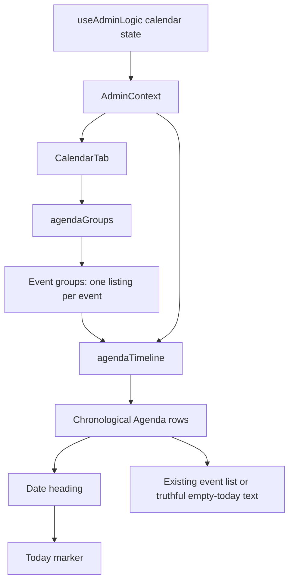

# L3 engineering journal — independent Agenda Today marker

Date: 8 October 2026
Scope: Admin Dashboard Calendar Agenda, L3 only

## Problem

The mobile Agenda rendered its `Today` marker only inside an existing event-group
heading. On 8 October 2026, the displayed event groups began on 3, 19 and 28
October. Because no event began on the 8th, the Agenda omitted today's logical
position even though the desktop calendar grid still marked the date.

This is a presentation gap. It does not indicate missing events: the existing
Agenda intentionally lists each event once under its start date.

## Root Cause

`agendaGroups` correctly creates rows only for dates that own event entries.
`CalendarTab` then derived the `Today` badge inside the map over those rows. The
badge therefore depended on an event group existing for today's date.

The dependency joined two different responsibilities:

- event grouping decides where each event is listed;
- the Agenda presentation decides whether the displayed month should show
  today's logical position.

The grouping contract did not need to change. The render input needed a small
presentation projection that could add today's position when no real group
already owned it.

## Existing Architecture

`useAdminLogic` supplies the fetched calendar events, displayed month/year,
active event-type filter and a single `today` value through `AdminContext`.
`CalendarTab` sends the events and display state to `agendaGroups`. That pure
helper clips events to the displayed month, applies the filter, assigns each
event to one start-date group and sorts groups by ISO date. `CalendarTab` maps
those groups into Agenda sections. Each section owns a date heading and its
event list; the heading previously also owned the conditional `Today` badge.

The desktop calendar grid and the mobile Agenda share the same source data but
use separate renderers. CSS shows the Agenda below 768px and the grid at 768px
and above.

## Component Relationships



## Data Flow

```text
Calendar events + displayed month + event-type filter
    -> agendaGroups
    -> sorted event groups
    -> agendaTimeline + today
    -> existing groups, plus one marker-only row when required
    -> CalendarTab Agenda sections
```

`agendaTimeline` returns the original groups unchanged when the displayed month
is not the current month or when today's real group already exists. Otherwise,
it returns a new sorted array with one marker-only row for today. It never
changes event membership.

## Existing Pattern Being Reused

The fix reuses the Agenda's existing section heading, `cal-agenda-today` badge,
date formatting, chronological ISO-date ordering, muted text token and mobile
breakpoint. It also follows the existing pure-helper pattern in
`frontend/src/lib/agenda.js`. No new component, layout pattern, color, or
interaction was introduced.

## UX Decision Log

### Existing behavior

The Agenda showed `Today` only when today's date was already an event-group
heading.

### Desired behavior

When the Agenda displays the current month, it should show exactly one Today
heading at today's chronological position. If no event starts today, it should
state that fact without duplicating a multi-day event or changing event groups.

### Why the existing behavior is problematic

On mobile, the Agenda replaces the calendar grid. Removing today's position
therefore removes the user's only date-orientation cue on that layout. The cue
appears and disappears based on event data even though the current date has not
changed.

### Alternatives considered

1. **Expand multi-day events into every covered day.** This would make some
   later days own rows, but it would duplicate events, increase Agenda length
   and break the established one-listing-per-event contract. Rejected.
2. **Make `agendaGroups` always emit an empty Today group.** This centralizes
   the behavior, but makes a grouping utility manufacture a presentation-only
   row and changes its output contract for all consumers. Rejected.
3. **Place a fixed Today banner above the Agenda.** This is simple, but loses
   chronological position and introduces a new visual pattern. Rejected.
4. **Project today's logical row after grouping.** A pure helper inserts one
   marker-only row only when needed, retains existing groups and sorting, and
   lets the existing heading render the badge. Chosen.

The chosen solution preserves component ownership: data grouping remains in
the Agenda helper, while CalendarTab still owns presentation and wording. Its
branches are explicit and covered by focused tests, which keeps maintenance and
regression risk low.

## Files Changed

### Primary

- `frontend/src/lib/agenda.js` — adds the pure `agendaTimeline` projection.
- `frontend/src/pages/dashboards/admin/tabs/CalendarTab.jsx` — renders the
  projected rows and truthful empty-today text.

### Supporting

- `frontend/src/pages/dashboards/admin/AdminDashboard.jsx` — adds one existing-
  token text rule for the marker-only row.

### Tests

- `frontend/src/lib/agenda.test.js` — covers insertion and ordering, duplicate
  prevention, immutability and non-current-month behavior.

### Documentation

- `docs/ux-l3-engineering-journal.md` — this implementation record.

## Why This Fix Is Safe

The event-grouping function is unchanged. The new helper is pure, does not
mutate its input and returns the same array when no projection is required.
Existing event rows and click handlers render through their prior branch. The
inserted row has no action, so it does not create a misleading interactive
target. It uses the existing date heading and Today badge, which preserves
semantics and accessible text.

The Agenda remains hidden at the established desktop breakpoint, and the
calendar grid is untouched. Both themes use existing tokens. Focus, event
editing, filters, toolbar behavior and network/data operations retain their
existing paths.

## Implementation Summary

Changed:

- added `agendaTimeline(groups, year, monthIndex, today)`;
- inserted one sorted marker-only row when today belongs to the displayed month
  and no real group exists for it;
- rendered `No events start today.` for that row, with filter-aware wording;
- added a small muted-text rule using existing type and color tokens;
- added three focused unit regressions.

Intentionally unchanged:

- event fetches, creation, editing and deletion;
- filtering rules;
- `agendaGroups` clipping, membership and sorting behavior;
- event cards, dates and ranges;
- calendar grid, toolbar and breakpoints;
- theme tokens and accessibility behavior;
- L4 and all unrelated responsive work.

## Verification

### Visual

Before evidence at 360/390 showed groups for 3, 19 and 28 October with no
heading or marker for 8 October. After evidence shows one `October 8, 2026 ·
Today` section between the 3 and 19 October groups, followed by `No events start
today.` Existing event cards, Upcoming items and visual hierarchy remain
unchanged. All screenshots were manually inspected.

### Responsive

Verified 360, 390, 768, 1024 and 1440px. At 360/390, the Agenda and marker are
visible and ordered 3, 8, 19, 28 October. At 768/1024/1440, the established grid
view remains visible and the Agenda remains hidden. Measured body overflow was
0px in every case.

### Theme

Verified light and dark themes at every required width. The Today badge keeps
the existing accent token and the empty sentence uses the existing muted text
token. No contrast or theme-specific layout regression was observed.

### Regression

Command:

```text
npm run test --workspace frontend -- src/lib/agenda.test.js
```

Result: 1 test file passed; 13 tests passed; 0 failed; 0 skipped. Vitest
reported 1.60s total duration and 29ms test duration. The first restricted
sandbox attempt did not start Vitest because Windows denied the esbuild child
process (`spawn EPERM`); the identical command was rerun with process-spawn
permission and passed. Three L3 regressions were added because the prior tests
covered event grouping but not today's independent presentation position.

### Manual

The browser matrix opened the Calendar, checked one Today marker, checked for
duplicate headings, measured overflow and opened/closed an event dialog at each
theme/width. At 390px it also selected the Deadline filter and confirmed the
filter-aware `No Deadline events start today.` message, then reset the filter.

### Evidence

- Before screenshots: `screenshots/admin-recovery-2026-10-08/before/`
- After screenshots: `screenshots/admin-recovery-2026-10-08/l3-after/`
- Machine observations:
  `screenshots/admin-recovery-2026-10-08/l3-after/observations.json`
- Ten matrix cases passed with one marker, no duplicate headings and no body
  overflow. The read-only harness recorded zero blocked write requests.

The screenshot and machine-evidence directories are intentionally ignored local
artifacts; the journal records their locations without adding generated images
to the product commit.

## Before vs After

### Before

- **Behavior:** Today appeared only if an event started today.
- **Visual result:** the mobile Agenda jumped from 3 October directly to 19
  October while the desktop grid still marked 8 October.
- **UX issue:** mobile users lost the current-date orientation cue because of
  unrelated event-group data.

### After

- **Behavior:** the current displayed month always has exactly one Today
  position; a real event group owns it when present, otherwise a marker-only row
  states that no events start today.
- **Visual result:** the existing date heading and badge appear in chronological
  order, with existing event sections unchanged.
- **UX improvement:** users retain date orientation without duplicated events,
  a new layout pattern, or a changed interaction model.

### Why better

The marker now follows the date it describes. Reusing the existing heading,
badge and tokens makes the correction visually native to the Admin Dashboard,
while the truthful empty text distinguishes an empty start date from missing or
still-loading data.

## Regression Risk

**LOW.** The change is isolated to the Agenda's render projection, has no write
path, preserves the event-grouping contract, and is covered across its three
logical branches. The affected UI was checked across both themes and all five
required widths. The remaining risk is limited to future consumers assuming
every projected row contains events; currently only CalendarTab consumes
`agendaTimeline`, and it handles `todayOnly` explicitly.

## Future Notes

- Keep `agendaGroups` responsible for event membership and `agendaTimeline`
  responsible for presentation rows if the Agenda gains more date landmarks.
- Preserve the exactly-one-marker invariant when changing date navigation or
  adding filters.
- L4 remains pending and was not started.
