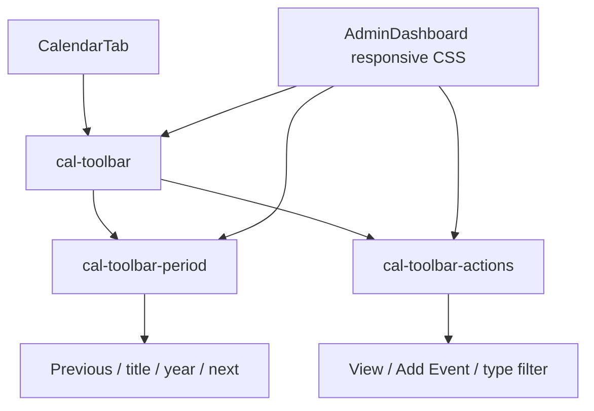

# L4 engineering journal — two-row narrow Calendar toolbar

Date: 8 October 2026
Scope: Admin Dashboard Calendar toolbar, L4 only

## Problem

At 360px, the Calendar toolbar occupied three rows. The first row held month
navigation and year, the second held the view selector and Add Event action,
and the event-type filter sat alone on a third row. At 390px the same controls
fit in two rows, proving that the extra row was a narrow-width packing issue
rather than an intentional hierarchy.

The isolated filter increased vertical travel and made controls with the same
task relationship look unrelated.

## Root Cause

`CalendarTab` rendered all seven controls as direct children of one wrapping
flex container. Each control used its intrinsic width. The toolbar also used a
12px gap, the view selector added an 8px left margin, and Add Event used an
automatic left margin.

At a 360px viewport, the Calendar content is 328px wide. The three second-row
controls and their spacing required more than that width, so normal flex
wrapping moved the type filter onto a third line. Nothing in the markup or CSS
identified the date controls and action controls as two groups.

## Existing Architecture

`CalendarTab` owns the toolbar markup and connects each control directly to the
existing Calendar state and handlers from `AdminContext`. `AdminDashboard.jsx`
owns the Calendar layout styles inside the existing dashboard style block.

The base `.cal-toolbar` uses flexbox and the dashboard spacing tokens. The
existing `max-width: 600px` Admin breakpoint already owns narrow Calendar
layout rules, while the `max-width: 1023.98px` breakpoint supplies 44px minimum
control heights. Shared Admin toolbars similarly replace accidental flex
packing with explicit child sizing at their responsive breakpoint.

## Component Relationships



## Data Flow

No application data flow changes.

The month navigation, year selection, Add Event handler, and event-type filter
retain their existing state values, callbacks and DOM order. L4 changes only
the boxes that participate in layout.

## Existing Pattern Being Reused

The shared Admin `.toolbar` rules already make responsive rows deliberate by
changing child sizing at an established breakpoint. L4 follows that pattern
for the Calendar-specific toolbar and reuses:

- the existing 600px Calendar breakpoint;
- `--space-8` and `--space-12` gaps;
- the existing 44px responsive target floor;
- existing select, button, typography and theme rules;
- grouped action-row layout already used by Admin controls.

No new visual language or breakpoint was added.

## UX Decision Log

### Current behavior

A flat wrapping flex row let intrinsic widths determine grouping. At 360px,
the type filter wrapped by itself onto row three.

### Problem

The visual grouping changed because of a small width difference, while the
controls' task relationships stayed the same. The extra row wasted space and
weakened the toolbar hierarchy.

### Alternatives considered

1. **Reduce font size or control padding.**
   - Advantage: could preserve the flat markup.
   - Disadvantages: harms readability and touch comfort; changes the control
     design to solve a layout problem.
   - Rejected because existing type and target sizes should remain stable.
2. **Shorten or hide a control.**
   - Advantage: immediately frees width.
   - Disadvantages: changes meaning or removes functionality; selected filter
     values may still be longer.
   - Rejected because all toolbar functions are required.
3. **Add a 360px positional override.**
   - Advantage: very small CSS patch.
   - Disadvantages: encodes one screenshot width and leaves grouping implicit.
   - Rejected as brittle and harder to maintain.
4. **Group related controls and explicitly size the narrow rows.**
   - Advantages: expresses the intended hierarchy, retains DOM order, supports
     intrinsic labels and reuses the existing responsive system.
   - Disadvantage: adds two non-semantic layout wrappers.
   - Chosen because it solves the cause with predictable layout ownership.

At tablet and desktop widths the wrappers use `display: contents`, so their
children participate in the original `.cal-toolbar` flex layout. At 600px and
below, the date group becomes one flex row and the action group becomes one
three-column grid row. This keeps the implementation readable and limits the
behavioral surface of the change.

## Files Changed

### Primary

- `frontend/src/pages/dashboards/admin/tabs/CalendarTab.jsx` — groups the
  existing controls and replaces layout-only inline styles with named classes.
- `frontend/src/pages/dashboards/admin/AdminDashboard.jsx` — defines base and
  narrow responsive behavior for those groups.

### Supporting

None.

### Tests

- `e2e/admin-polish.spec.js` — adds a focused 360px regression for two rows,
  group integrity, overflow, longest-option selection and keyboard/DOM order.

### Documentation

- `docs/ux-l4-engineering-journal.md` — this implementation record.

## Engineering Impact Analysis

| Area | Affected | Explanation |
|---|---|---|
| Calendar Grid | NO | Grid markup and CSS are unchanged. |
| Agenda | NO | Agenda markup, logic and styling are unchanged. |
| Filtering Logic | NO | The same value, options and `setCalFilter` callback remain. |
| Toolbar Layout | YES | Related controls now form two explicit narrow rows. |
| Theme Tokens | NO | Existing tokens are reused; no token changed or added. |
| Accessibility | NO behavioral change | DOM/keyboard order, native controls, names and 44px narrow targets remain. |
| Responsive System | YES, locally | The existing 600px breakpoint gains Calendar toolbar group rules. |
| Shared Components | NO | No shared component API or implementation changed. |
| Performance | NO | Static wrappers and constant-time CSS layout add no meaningful work. |

## Complexity Analysis

Before: **O(1)** layout structure and event handling.

After: **O(1)** layout structure and event handling.

The number of controls is fixed. No loop, data transformation, request, state,
or behavioral complexity was introduced.

## Why This Fix Is Safe

The change preserves every control and handler in the same DOM order. Above the
narrow breakpoint, `display: contents` preserves the prior flex participants
and one-row tablet/desktop layout. Below it, only grouping and track sizing
change. The existing spacing tokens, control rules and theme surfaces continue
to render the controls.

The fix does not touch Calendar state, navigation logic, filters, event writes,
grid cells, Agenda content or dialogs. The focused regression and browser
matrix check the root condition rather than relying only on screenshots.

## Implementation Summary

Changed:

- wrapped previous/title/year/next in `cal-toolbar-period`;
- wrapped view/Add Event/filter in `cal-toolbar-actions`;
- moved the three layout-only inline declarations to named CSS classes;
- retained the original flat flex behavior outside the narrow breakpoint;
- made the narrow period group one flex row;
- made the narrow action group a three-column grid using existing 8px spacing;
- added one focused browser regression.

Intentionally unchanged:

- control labels, options, values and callbacks;
- Calendar filtering and navigation behavior;
- Add Event behavior and modal;
- Calendar grid and Agenda;
- typography, colors, theme tokens and breakpoints;
- L1–L3 implementations and unrelated responsive rules.

## Verification

### Visual

All ten after screenshots were manually inspected. At 360 and 390px, the date
controls occupy row one and Month/Add Event/Custom Type occupy row two. Labels
are readable, controls align, and spacing matches the existing dashboard. At
768, 1024 and 1440px, the toolbar remains on one row.

### Responsive

Verified 360, 390, 768, 1024 and 1440px. Measured toolbar rows were 2, 2, 1, 1
and 1 respectively in both themes. Each group remained internally on one row.
Body and toolbar overflow were 0px in all cases.

At 360/390/768, all measured controls retained the existing 44px height. At
1024/1440 the existing desktop density remains unchanged.

### Theme

Verified light and dark themes at all five widths. No L4 colors were added;
existing button, select, border, surface and focus styles continue to supply
theme behavior.

### Regression

Commands executed:

```text
npx playwright test e2e/admin-polish.spec.js --grep "L4:"
```

Result: 1 passed, 0 failed, 0 skipped; 9.8s total, 3.4s test duration.

```text
npx playwright test e2e/admin-polish.spec.js --grep "calendar controls"
```

Result: 4 passed, 0 failed, 0 skipped; 20.5s total. This includes the new L4
regression plus existing 360/768/1440 Calendar target-size checks.

The browser evidence harness was refined three times before the successful
matrix: it first requested a non-existent `Announcement` option, then compared
top edges of differently-height aligned items, then incorrectly applied the
sub-1024 target rule at exactly 1024px. These were harness assumptions, not
application failures. The corrected run passed all ten cases.

### Manual

- inspected every required screenshot;
- selected the longest existing event type, `Custom Type`;
- opened and closed Add Event at every width/theme;
- confirmed unchanged control order;
- confirmed no clipping or horizontal overflow;
- confirmed no write request was issued.

### Evidence

- Before screenshots: `screenshots/admin-recovery-2026-10-08/before/`
- After screenshots: `screenshots/admin-recovery-2026-10-08/l4-after/`
- Measurements:
  `screenshots/admin-recovery-2026-10-08/l4-after/observations.json`

The screenshot directories and verification harness are ignored local evidence
and are not product commit content.

## Before vs After

### Before

- **Behavior:** flexbox wrapped controls according to intrinsic width.
- **Layout:** three rows at 360px; the type filter occupied row three alone.
- **UX issue:** excess height and unstable grouping made related controls look
  disconnected.

### After

- **Behavior:** controls and handlers behave identically.
- **Layout:** two deliberate rows at 360/390px and the existing single row at
  768/1024/1440px.
- **Improvement:** related controls remain together, labels remain readable,
  and the toolbar uses less vertical space without reducing targets.

### Why better

The layout now expresses the toolbar's existing hierarchy instead of allowing
the final few pixels to decide it. It uses the same controls, tokens, spacing
scale and responsive breakpoint, so the result reads as the existing Admin
Dashboard rather than a redesigned toolbar.

## Regression Risk

**LOW.** The implementation is local, static and layout-only. The original DOM
and keyboard order, state wiring and behavior remain. Both responsive branches,
both themes, the longest label, target sizes and overflow have direct evidence.

## Future Notes

- Keep the two group boundaries if toolbar labels or actions change.
- Recheck the 360px row when adding another control or lengthening a label.
- L4 is the final approved recovery finding. No cleanup, final validation, or
  additional UX work was started.
